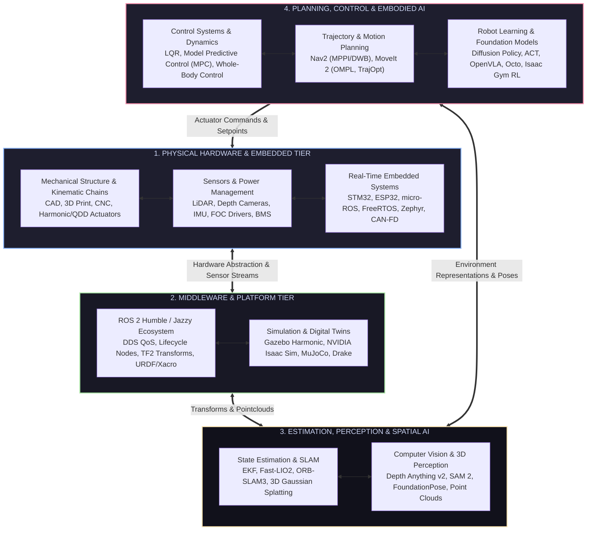

<div align="center">

# 🤖 THE ROBOTICS LEARNING HUB 🚀
### *The Definitive, Zero-to-Production Knowledge Base & Engineering Matrix for Modern Robotics*

[](https://github.com/Flux-15/robotics-learning-hub)
[](https://docs.ros.org/)
[](LICENSE)
[](CONTRIBUTING.md)
[](https://github.com/Flux-15/robotics-learning-hub)
[](https://github.com/Flux-15/robotics-learning-hub)

<p align="center">
  <b>A world-class, rigorously structured encyclopedia bridging classical mechanics, control theory, spatial AI, modern ROS 2, and foundation models.</b>
  <br />
  From raw silicon and brushless motors to Vision-Language-Action (VLA) humanoids.
</p>

---

### ⚡ Quick Navigation

[ 🗺️ Master Roadmap ](robotics-roadmap.md) &nbsp;•&nbsp;
[ 📚 Domain Matrix ](#-domain-matrix) &nbsp;•&nbsp;
[ 🛠️ Hardware Projects ](robotics_projects/resources.md) &nbsp;•&nbsp;
[ 🔬 Landmark Papers ](research_papers/resources.md) &nbsp;•&nbsp;
[ 📑 Cheat Sheets ](cheatsheets/README.md) &nbsp;•&nbsp;
[ 🎯 Career Tracks ](#-career--specialization-tracks) &nbsp;•&nbsp;
[ 🤝 Contributing ](CONTRIBUTING.md)

---

</div>

## 🌐 The Full-Stack Robotics Architecture

Robotics is not a single discipline—it is the synthesis of mechanics, electronics, low-level firmware, real-time control, spatial perception, and high-level decision intelligence.



---

## 🗂️ Domain Matrix

Explore the comprehensive sub-manuals and resource hubs across all domains of robotics engineering. Each directory features deep conceptual walkthroughs, standard toolsets, curated media, and interactive cheat sheets.

| Domain | Focus & Core Technologies | Key Skills Taught | Direct Link |
| :--- | :--- | :--- | :--- |
| **💻 Programming & Linux** | Modern C++ (17/20), Python 3.12, Linux CLI, Bash, Git, Docker, CMake | Memory safety, real-time threads, containerized dev, build tooling | [Explore Module ➔](programming/README.md) |
| **📐 Mathematics for Robotics** | Linear Algebra, Lie Groups ($SO(3), SE(3)$), Screw Theory, Optimization | Frame transforms, PoE formula, QP solvers, Jacobians | [Explore Module ➔](mathematics/README.md) |
| **⚡ Electronics & Power** | Schematics, BMS, Buck/Boost, FOC Motor Drivers, EMI, KiCad 8 | Power budgets, high-current routing, sensor interfacing | [Explore Module ➔](electronics/README.md) |
| **📟 Embedded Systems** | STM32, ESP32, micro-ROS, FreeRTOS, Zephyr, CAN-FD, SPI/I2C | Hard real-time control loops, interrupt handlers, hardware timers | [Explore Module ➔](embedded_systems/README.md) |
| **⚙️ Mechanical Design** | CAD (Fusion 360, Onshape), Actuators (BLDC, Harmonic, QDD), 3D Print | Linkage design, gear reduction calculation, structural rigidity | [Explore Module ➔](mechanical_design/README.md) |
| **🦾 Robotics Fundamentals** | Forward & Inverse Kinematics, Dynamics, DH vs Screws, Trajectories | Manipulator math, Euler-Lagrange equations, singularity avoidance | [Explore Module ➔](robotics_fundamentals/README.md) |
| **🎛️ Control Systems** | PID, State-Space, LQR, Model Predictive Control (MPC), WBC | Closed-loop stabilization, trajectory tracking, disturbance rejection | [Explore Module ➔](control_systems/README.md) |
| **🤖 ROS 2 Ecosystem** | ROS 2 Humble/Jazzy, DDS QoS, Nav2, MoveIt 2, TF2, URDF/Xacro | Distributed nodes, multi-robot communication, autonomous navigation | [Explore Module ➔](ros/README.md) |
| **🎮 Simulation & Digital Twins** | Gazebo Harmonic, NVIDIA Isaac Sim/Lab, MuJoCo, Drake, PyBullet | Physics simulation, synthetic data generation, GPU-accelerated RL | [Explore Module ➔](simulation/README.md) |
| **👁️ Computer Vision & 3D** | OpenCV, SAM 2, Depth Anything, FoundationPose, Point Clouds, 3DGS | 6D object pose, spatial mapping, depth extraction, segmentation | [Explore Module ➔](computer_vision/README.md) |
| **🧠 AI & Robot Learning** | Imitation Learning (ACT, Diffusion Policy), VLA (OpenVLA), RL, Sim-to-Real | Autonomous manipulation, policy learning, natural language actions | [Explore Module ➔](ai_ml/README.md) |
| **📊 Datasets & Benchmarks** | NuScenes, KITTI, Open X-Embodiment (RT-X), DROID, DexNet | Sourcing training data, benchmark evaluation, multimodal datasets | [Explore Module ➔](datasets/README.md) |
| **🔬 Landmark Research Papers** | Annotated foundational papers: SLAM, Planning, Embodied AI | Deep understanding of academic breakthroughs & math proofs | [Explore Module ➔](research_papers/README.md) |
| **🛠️ Hardware & Sim Projects** | End-to-end guided builds: Rovers, Arms, Drones, Quadrupeds | Practical implementation, schematics, full BOM, source code | [Explore Module ➔](robotics_projects/README.md) |
| **📑 Engineering Cheatsheets** | Quick-reference guides: ROS 2 CLI, Math formulas, Pinouts, Linux | Instant lookup for daily laboratory and coding workflows | [Explore Module ➔](cheatsheets/README.md) |

---

## 🚀 The 0-to-Hero Quickstart

If you're completely new or transitioning into robotics from pure software or pure mechanical engineering, follow this golden sequence:

```
[Step 1: Programming & Tools] ──> Master Linux, C++20, Python 3.12, and Git
        │
        ▼
[Step 2: Math & Electronics]  ──> Linear Algebra ($SE(3)$), Circuit basics & Microcontrollers
        │
        ▼
[Step 3: ROS 2 & Simulation]  ──> ROS 2 Humble/Jazzy, URDF creation, and Gazebo/MuJoCo
        │
        ▼
[Step 4: Classical Autonomy]  ──> State Estimation (EKF/SLAM), Control (PID/LQR), Nav2
        │
        ▼
[Step 5: Modern Intelligence] ──> Spatial AI (Point Clouds, 3DGS) & Robot Learning (Diffusion Policy)
```

> [!TIP]
> For a detailed week-by-week curriculum with milestones, book chapters, and practice challenges, check out the **[Full Robotics Roadmap](robotics-roadmap.md)**.

---

## 🎯 Career & Specialization Tracks

Modern robotics has bifurcated into distinct high-demand roles. Here is the exact stack needed for each specialization:

<details>
<summary><b>1. Autonomous Mobile Robots (AMR) & Self-Driving Vehicles</b></summary>
<br>

- **Core Stack:** ROS 2, Nav2, C++, SlamToolbox, Fast-LIO2, EKF / UKF, CAN Bus, LiDAR, Depth Cameras.
- **Key Concepts:** Costmaps, MPPI / Regulated Pure Pursuit controllers, loop closure, graph SLAM, obstacle avoidance.
- **Recommended Projects:** [2D LiDAR SLAM & Autonomous Mapping Rover](robotics_projects/intermediate/slam_robot.md), [Vision-Based Navigation](robotics_projects/advanced/vision_based_navigation_robot.md).
- **Target Companies:** Waymo, Amazon Robotics, Boston Dynamics, Locus Robotics, Otto Motors.
</details>

<details>
<summary><b>2. Robotic Manipulation & Arm Systems</b></summary>
<br>

- **Core Stack:** MoveIt 2, OMPL, TrajOpt, Kinematics (PoE, Jacobians), Force/Torque sensing, Tactile sensors, OpenCV.
- **Key Concepts:** Singularity avoidance, Cartesian path planning, impedance/admittance control, pick-and-place pipelines.
- **Recommended Projects:** [4-DoF Robotic Arm with Inverse Kinematics](robotics_projects/intermediate/robotic_arm_ik.md), [AI Vision-Language-Action Manipulator](robotics_projects/advanced/vla_manipulator.md).
- **Target Companies:** Universal Robots, ABB, KUKA, FANUC, Figure AI, Covariant.
</details>

<details>
<summary><b>3. Legged Locomotion (Humanoids & Quadrupeds)</b></summary>
<br>

- **Core Stack:** Whole-Body Control (WBC), Model Predictive Control (MPC), High-torque QDD / Planetary Actuators, MuJoCo, Isaac Gym, Reinforcement Learning (PPO).
- **Key Concepts:** Zero Moment Point (ZMP), Centroidal dynamics, contact scheduling, blind & terrain-adaptive locomotion.
- **Recommended Projects:** [Self-Balancing Inverted Pendulum Robot](robotics_projects/intermediate/self_balancing_robot.md), [Quadruped Robot Dog Build](robotics_projects/advanced/quadruped_robot.md).
- **Target Companies:** Boston Dynamics, Unitree, Figure AI, Tesla (Optimus), Agility Robotics, Sanctuary AI.
</details>

<details>
<summary><b>4. Aerial Robotics & Autonomous Drones</b></summary>
<br>

- **Core Stack:** PX4 Autopilot, ArduPilot, MAVROS / micro-XRCE-DDS, C++, VIO (Visual Inertial Odometry), Optical Flow.
- **Key Concepts:** Cascaded PID attitude control, SE(3) geometric tracking, minimum snap trajectory generation, offboard mode.
- **Recommended Projects:** [Autonomous Drone with PX4 & Offboard Navigation](robotics_projects/advanced/autonomous_drone.md).
- **Target Companies:** Skydio, DJI, Zipline, Wing, Shield AI, Anduril.
</details>

<details>
<summary><b>5. Embodied AI & Robot Learning Researcher</b></summary>
<br>

- **Core Stack:** PyTorch, LeRobot, Stable-Baselines3, MuJoCo, Isaac Lab, OpenVLA, Diffusion Policy, Transformers.
- **Key Concepts:** Visuomotor policy learning, imitation learning from human teleoperation, Sim-to-Real transfer, multimodal action tokens.
- **Recommended Projects:** [AI Vision-Language-Action Desktop Manipulator](robotics_projects/advanced/vla_manipulator.md).
- **Target Labs:** Google DeepMind Robotics, Berkeley BAIR, Stanford REAL, Toyota Research Institute (TRI), Meta FAIR.
</details>

---

## 🌟 Gold-Standard Open-Source Repositories

| Repository | Description | Stars |
| :--- | :--- | :--- |
| [AtsushiSakai/PythonRobotics](https://github.com/AtsushiSakai/PythonRobotics) | Python sample codes for all classic robotics algorithms | ⭐ 23k+ |
| [ros2/ros2](https://github.com/ros2/ros2) | The core Robot Operating System 2 | ⭐ 4.5k+ |
| [ros-planning/navigation2](https://github.com/ros-planning/navigation2) | Professional navigation stack for mobile robots | ⭐ 2.5k+ |
| [ros-planning/moveit2](https://github.com/ros-planning/moveit2) | Motion planning and manipulation framework | ⭐ 1.8k+ |
| [huggingface/lerobot](https://github.com/huggingface/lerobot) | State-of-the-art machine learning library for real-world robotics | ⭐ 11k+ |
| [openvla/openvla](https://github.com/openvla/openvla) | Open-source 7B parameter Vision-Language-Action model | ⭐ 3k+ |
| [google-deepmind/mujoco](https://github.com/google-deepmind/mujoco) | Ultra-fast multi-joint physics engine with contact dynamics | ⭐ 8k+ |
| [Livox-SDK/FAST_LIO](https://github.com/hku-mars/FAST_LIO) | Computationally efficient LiDAR-inertial odometry package | ⭐ 3k+ |
| [nerfstudio-project/nerfstudio](https://github.com/nerfstudio-project/nerfstudio) | Framework for end-to-end NeRF development & 3D Gaussian Splatting | ⭐ 9k+ |

---

## 🛠️ Complete Project Guides Directory

Every project in this repository includes complete **Bill of Materials (BOM)**, electrical schematics, software setup, code, and troubleshooting.

```
robotics_projects/
├── beginner/
│   ├── line_following_robot.md      ── PID controlled differential drive
│   ├── obstacle_avoidance_robot.md  ── Ultrasonic/LiDAR reactive mobile base
│   └── pan_tilt_vision_turret.md    ── 2-DoF OpenCV target tracking gimbal
├── intermediate/
│   ├── slam_robot.md                ── 2D LiDAR + ROS 2 Nav2 autonomous mapping
│   ├── maze_solving_robot.md        ── Flood-fill micromouse algorithm
│   ├── self_balancing_robot.md      ── Inverted pendulum with Kalman Filter & LQR
│   └── robotic_arm_ik.md            ── 4-DoF arm with analytical Inverse Kinematics
└── advanced/
    ├── autonomous_drone.md          ── PX4 + ROS 2 offboard waypoint navigation
    ├── vision_based_navigation.md   ── Visual SLAM + monocular depth obstacle avoidance
    ├── quadruped_robot.md           ── 12-DoF BLDC quadruped locomotion
    ├── vla_manipulator.md           ── Diffusion Policy / LeRobot desktop manipulator
    └── multi_robot_systems.md       ── Swarm formation & decentralized consensus
```

---

## 🤝 Contributing & Community

We are building the world's most complete, rigorous, and accessible robotics hub. If you find a broken link, want to submit a new research paper review, add a project build, or improve an explanation:

1. Read our **[Contribution Guide](CONTRIBUTING.md)**.
2. Check existing issues or submit a pull request.
3. Adhere to our high-standard technical formatting and clear markdown standards.

---

<div align="center">

### ⭐ If this repository powers your learning or projects, star it on GitHub! ⭐

*Built with passion for robotics engineers, researchers, students, and makers worldwide.*

[ Back to Top ↑ ](#-the-robotics-learning-hub-)

</div>
