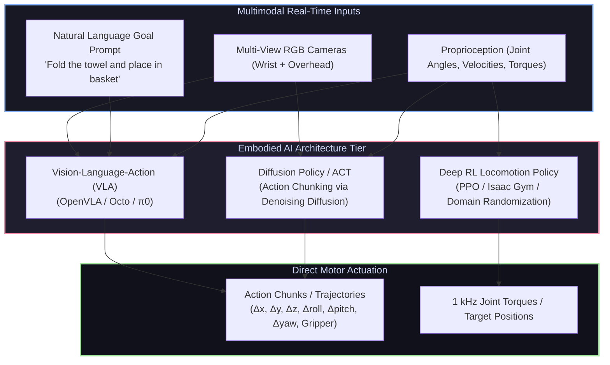

# 🧠 Artificial Intelligence, Machine Learning & Embodied AI

[ 🏠 Hub Home ](../README.md) &nbsp;•&nbsp; [ 🗺️ Full Roadmap ](../robotics-roadmap.md) &nbsp;•&nbsp; [ 📊 Datasets & Benchmarks ➡️ ](../datasets/README.md)

---

## 📌 Overview & Scope
We have entered the era of **Embodied AI**: moving machine learning out of disembodied text and pixels and placing it into physical robots that interact with the physical world. 

Modern robot intelligence centers on three pillars:
1. **Imitation Learning & Visuomotor Policies (ACT, Diffusion Policy):** Learning complex, high-frequency physical manipulation directly from human teleoperation demonstrations.
2. **Deep Reinforcement Learning & Sim-to-Real (PPO, SAC, Isaac Gym):** Discovering agile locomotion and dynamic maneuvers through millions of trial-and-error interactions across GPU-parallel physics simulators.
3. **Vision-Language-Action (VLA) Foundation Models (OpenVLA, Octo, $\pi_0$):** Unifying web-scale visual-linguistic reasoning with physical actuation, allowing robots to understand complex natural language instructions and generalize zero-shot to unseen objects.

---

## 🔑 Core Technical Concepts

### 1. Modern Imitation Learning: ACT & Diffusion Policy
Classical Behavioral Cloning (BC) suffers from **covariate shift**: small prediction errors drift the robot into states never seen in the training dataset, resulting in catastrophic failure.

* **Action Chunking with Transformers (ACT):**
  * Instead of predicting a single action $a_t$ given current observation $o_t$, ACT predicts a continuous **chunk** of $k$ future actions:
    $$[a_t, a_{t+1}, \dots, a_{t+k}] = \pi(o_t)$$
  * Formulated with a Conditional VAE (CVAE) and a Transformer encoder-decoder.
  * Temporal ensembling blends overlapping chunk predictions over time, yielding silky-smooth, human-like dexterity.
* **Diffusion Policy (Visuomotor Policy as a Diffusion Process):**
  * Formulates action generation as an iterative **Denoising Diffusion Probabilistic Model (DDPM)**.
  * Starting from pure Gaussian noise, the model iteratively denoises the trajectory conditioned on visual embeddings:
    $$p_\theta(\mathbf{A}_0 \mid \mathbf{O}) = \int \prod_{t=1}^T p_\theta(\mathbf{A}_{t-1} \mid \mathbf{A}_t, \mathbf{O}) \, d\mathbf{A}_{1:T}$$
  * *Why Diffusion Wins:* Human demonstrations are multimodal (e.g., dodging an obstacle left OR right). Standard neural nets average both paths, steering directly into the obstacle. Diffusion policies model arbitrary multi-modal probability distributions cleanly.

### 2. Vision-Language-Action (VLA) Foundation Models
* **The Architecture:** Takes a pretrained Vision-Language Model (VLM, such as Llama or PaLI), attaches a visual projector to encode camera views, and discretizes the robot's action space (7-DoF: $[x, y, z, \text{roll}, \text{pitch}, \text{yaw}, \text{gripper}]$) into discrete vocabulary tokens.
* **Landmark Open-Source Models:**
  * **OpenVLA (7B):** Open-source generalist manipulation model built on Llama-2 and Prismatic VLM, pretrained on 970k diverse robot trajectories from the Open X-Embodiment dataset.
  * **Octo (UC Berkeley):** Transformer-based generalist policy with flexible observation tokenizers (supporting arbitrary camera combinations and language or goal-image conditioning).
  * **$\pi_0$ (Physical Intelligence):** Flow-matching foundation model achieving breakthrough dexterity on complex laundry folding and assembly tasks.

### 3. Deep Reinforcement Learning for Locomotion
* **Proximal Policy Optimization (PPO):** The workhorse policy gradient algorithm used to train quadruped and bipedal humanoid walking policies.
* **Reward Engineering via LLMs (Eureka):** NVIDIA's Eureka uses frontier LLMs to write, evaluate, and iteratively refine Python reward functions in Isaac Gym, outperforming human reward designers on complex dexterous tasks (e.g., pen spinning).

### 4. Hugging Face LeRobot
* **[LeRobot](https://github.com/huggingface/lerobot):** The industry-standard open-source ecosystem designed to democratize real-world robotics with PyTorch:
  * Unified dataset format for recording and streaming multi-camera demonstration data.
  * Out-of-the-box implementations of ACT, Diffusion Policy, and TD-MPC.
  * Native hardware support for accessible open-hardware arms (SO-ARM100, Koch v1.1).

---

## 🛠️ Industry Standard AI / ML Toolchain

| Tool / Framework | Creator | Role |
| :--- | :--- | :--- |
| **[Hugging Face LeRobot](https://github.com/huggingface/lerobot)** | Hugging Face | State-of-the-art imitation learning library for real-world robotics |
| **[OpenVLA](https://github.com/openvla/openvla)** | Stanford / Berkeley | 7B parameter open-source Vision-Language-Action policy |
| **[Stable-Baselines3](https://github.com/DLR-RM/stable-baselines3)** | DLR-RM | Reliable PyTorch implementations of reinforcement learning algorithms (PPO, SAC) |
| **[Gymnasium](https://gymnasium.farama.org/)** | Farama Foundation | Standard API for reinforcement learning environments |
| **[PyTorch](https://pytorch.org/)** | Meta / Linux Foundation | Deep learning framework powering all modern Embodied AI research |

---

## 📚 Curated Learning Media

### 🎓 Premier Courses & Lectures
- [Andrej Karpathy: Neural Networks: Zero to Hero (YouTube)](https://www.youtube.com/playlist?list=PLAqhIrjkxbuWI23v9cThsA9GvCAUhRvKZ) — Unmatched intuitive understanding of backpropagation, transformers, and tokenization.
- [Hugging Face Deep Reinforcement Learning Course](https://huggingface.co/learn/deep-rl-course/unit0/introduction) — Free, interactive course covering Q-learning, Policy Gradients, and PPO.
- [David Silver: Reinforcement Learning Course (UCL / DeepMind)](https://www.youtube.com/playlist?list=PLqYmG7hTraZDM-OYHWgPebj2MfCFzFObQ) — The theoretical foundation of RL.
- [CS285: Deep Reinforcement Learning (Prof. Sergey Levine, UC Berkeley)](https://rail.eecs.berkeley.edu/deeprlcourse/) — Advanced deep RL and visuomotor policy learning.

### 📖 Essential Books & Key Literature
- *Reinforcement Learning: An Introduction (2nd Edition)* by Richard S. Sutton and Andrew G. Barto (Free PDF).
- *Deep Learning* by Ian Goodfellow, Yoshua Bengio, and Aaron Courville.
- *OpenVLA: An Open-Source Vision-Language-Action Model* (Kim et al., 2024).
- *Diffusion Policy: Visuomotor Policy Learning via Action Diffusion* (Chi et al., 2023).
- *Learning Fine-Grained Bimanual Manipulation with Low-Cost Hardware* (Zhao et al., 2023 - ACT paper).

### 💻 Open-Source Repositories
- [huggingface/lerobot](https://github.com/huggingface/lerobot) — PyTorch robotics library.
- [openvla/openvla](https://github.com/openvla/openvla) — 7B open-source VLA model.
- [real-stanford/diffusion_policy](https://github.com/real-stanford/diffusion_policy) — Official Diffusion Policy codebase.
- [tonyzhaozh/act](https://github.com/tonyzhaozh/act) — Official Action Chunking with Transformers (ACT) implementation.

---

[ ⬅️ Previous: Computer Vision ](../computer_vision/README.md) &nbsp;•&nbsp; [ Next: Datasets & Benchmarks ➡️ ](../datasets/README.md)

