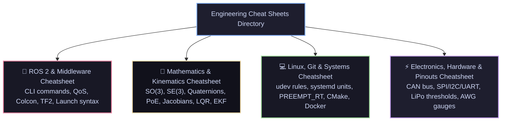

# 📑 Robotics Engineering Cheat Sheets & Rapid Reference Matrix

[ 🏠 Hub Home ](../README.md) &nbsp;•&nbsp; [ 🗺️ Full Roadmap ](../robotics-roadmap.md) &nbsp;•&nbsp; [ 🛠️ Hardware Projects ](../robotics_projects/resources.md)

---

## 📌 Overview & Scope
During laboratory bringup, debugging at the test bench, or coding late at night, you don't want to re-read a 600-page textbook just to recall the syntax for a ROS 2 lifecycle transition, the Rodrigues rotation matrix formula, an active CAN-FD bus termination check, or a `udev` hardware rule.

This directory houses **field-tested, condensed cheat sheets** engineered for immediate reference.

---

## 📑 Quick Navigation

| Cheat Sheet | Primary Contents | Direct Link |
| :--- | :--- | :--- |
| **🤖 ROS 2 CLI & Nav2** | Topic/Service/Action commands, Lifecycle nodes, TF2 debugging, QoS syntax, Colcon flags | [Open Cheat Sheet ➔](ros2-cheatsheet.md) |
| **📐 Mathematics & Kinematics** | Rotation matrices, Quaternion operations, PoE formula, Spatial Jacobians, LQR Riccati, Kalman Filter | [Open Cheat Sheet ➔](math-formulas-cheatsheet.md) |
| **💻 Linux, Git & Tooling** | Persistent `/dev` symlinks (udev), systemd startup services, real-time priority, CMake targets, Git LFS | [Open Cheat Sheet ➔](linux-and-git-cheatsheet.md) |
| **⚡ Hardware, Bus & Pinouts** | CAN bus termination, SPI vs I2C vs UART wiring, LiPo cell voltage limits, AWG wire sizing, Motor torque | [Open Cheat Sheet ➔](hardware-and-pinouts.md) |

---

[ ⬅️ Return to Hub Home ](../README.md)

