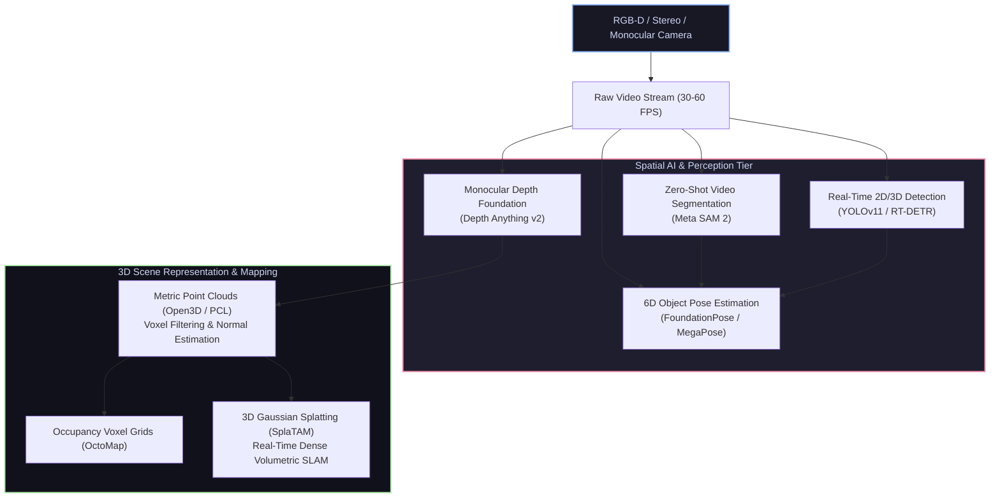

# 👁️ Computer Vision & Spatial AI for Robotics

[ 🏠 Hub Home ](../README.md) &nbsp;•&nbsp; [ 🗺️ Full Roadmap ](../robotics-roadmap.md) &nbsp;•&nbsp; [ 🧠 AI & Robot Learning ➡️ ](../ai_ml/README.md)

---

## 📌 Overview & Scope
Robotic vision is fundamentally different from traditional computer vision. Robots do not merely classify pictures; they exist **inside** a dynamic, three-dimensional physical environment. 

A robot must extract metric spatial relationships: estimating the 6-DoF pose of an object to grasp it with millimeter precision, detecting drivable surfaces, segmenting obstacles in real-time, and reconstructing dense 3D maps using **Point Clouds**, **Depth Anything v2**, **Segment Anything (SAM 2)**, and **3D Gaussian Splatting (3DGS)**.

---

## 🔑 Core Technical Concepts

### 1. Pinhole Camera Model & Epipolar Geometry
* **Intrinsic Camera Matrix ($K$):** Projects 3D camera coordinates $(X, Y, Z)$ into 2D pixel coordinates $(u, v)$:
  $$\begin{bmatrix} u \\ v \\ 1 \end{bmatrix} = \frac{1}{Z} \begin{bmatrix} f_x & 0 & c_x \\ 0 & f_y & c_y \\ 0 & 0 & 1 \end{bmatrix} \begin{bmatrix} X \\ Y \\ Z \end{bmatrix}$$
  * $f_x, f_y$: Focal lengths in pixels.
  * $c_x, c_y$: Principal point (optical center).
* **Lens Distortion:** Radial distortion ($k_1, k_2, k_3$) causing barrel/pincushion curvature, and tangential distortion ($p_1, p_2$) from sensor misalignment. Corrected using OpenCV calibration with ChArUco target boards.
* **Stereo Triangulation:** Given stereo baseline $B$ and measured disparity $d = u_L - u_R$:
  $$Z = \frac{f \cdot B}{d}$$

### 2. State-of-the-Art Spatial AI Models (2025/2026)
* **Depth Anything v2:** Monocular depth estimation trained on massive unlabeled datasets. Produces crisp, fine-grained metric depth maps from a single standard RGB camera, identifying fine cables, thin chair legs, and transparent objects where active IR sensors fail.
* **Segment Anything 2 (SAM 2):** Meta's foundation model for promptable visual segmentation in images and video streams. Allows a robot arm to track an arbitrary target object across dynamic occlusions in real time.
* **FoundationPose:** Universal 6D object pose estimation and tracking framework. Given a CAD model or a few reference photos, it estimates the exact 3D position and orientation of unseen objects without requiring object-specific neural network retraining.
* **YOLOv11 & RT-DETR:** Real-time object detection models providing sub-10 millisecond inference on edge GPUs (e.g., NVIDIA Jetson Orin).

### 3. 3D Point Cloud Processing
* **Open3D & Point Cloud Library (PCL):**
  * **Voxel Grid Downsampling:** Discretizes space into a 3D grid of cubic voxels (e.g., $1\text{cm}^3$), replacing all points in a voxel with their centroid to drastically reduce computational load.
  * **Statistical Outlier Removal (SOR):** Computes mean distance to $k$-nearest neighbors; removes sparse flying pixels caused by LiDAR/depth reflections.
  * **Iterative Closest Point (ICP):** Iteratively minimizes Euclidean distance between corresponding points in two overlapping scans to calculate the rigid body transformation ($R, \mathbf{t}$) between frames.

### 4. 3D Gaussian Splatting (3DGS) in Robotics
* Unlike traditional point clouds which are sparse, or NeRFs which require heavy neural network ray-marching, 3DGS models scenes using millions of explicit **3D anisotropic Gaussians** parameterized by center $\boldsymbol{\mu}$, covariance $\boldsymbol{\Sigma}$, opacity $\alpha$, and spherical harmonics color.
* Renders at **150+ FPS** at 1080p, unlocking real-time dense volumetric SLAM (**SplaTAM**) and photorealistic simulation generation.

---

## 🛠️ Industry Standard Vision Toolchain

| Tool / Framework | Language | Primary Robotics Use Case |
| :--- | :--- | :--- |
| **[OpenCV](https://opencv.org/)** | C++ / Python | Image filtering, camera calibration, feature extraction, morphological operations |
| **[Open3D](http://www.open3d.org/)** | Python / C++ | Fast 3D data processing, point cloud registration, surface normal calculation |
| **[Segment Anything 2 (SAM 2)](https://github.com/facebookresearch/segment-anything-2)** | Python / PyTorch | Zero-shot real-time video object segmentation and target tracking |
| **[Depth Anything v2](https://github.com/DepthAnything/Depth-Anything-V2)** | Python / PyTorch | Highly robust monocular depth estimation |
| **[FoundationPose](https://github.com/NVlabs/FoundationPose)** | Python / CUDA | 6D object pose estimation and tracking for robotic manipulation |
| **[OctoMap](https://octomap.github.io/)** | C++ | Probabilistic 3D occupancy voxel mapping for MoveIt 2 collision avoidance |

---

## 📚 Curated Learning Media

### 🎓 Premier Courses & Lectures
- [First Principles of Computer Vision (Prof. Shree Nayar, Columbia CVCA)](https://www.youtube.com/@FirstPrinciplesofComputerVision) — The single most authoritative lecture series on optics, radiometry, camera calibration, and stereo vision.
- [Stanford CS231n: Deep Learning for Computer Vision](https://www.youtube.com/playlist?list=PL3FW7Lu3i5JvHM8ljYj-zLfQRF3EO8sYv) — Convolutional neural networks, object detection, and transformers.
- [Cyrill Stachniss: Photogrammetry & Laser Scanning (Uni Bonn)](https://www.youtube.com/playlist?list=PLgnQpQtFTOGQh_J16imsvziOrq3N4fTQO) — 3D point cloud processing, ICP, and bundle adjustment.

### 📖 Essential Books
- *Computer Vision: Algorithms and Applications (2nd Edition)* by Richard Szeliski (Free online PDF).
- *Multiple View Geometry in Computer Vision* by Richard Hartley and Andrew Zisserman — The undisputed theoretical bible of multi-view geometry.
- *Learning OpenCV 4* by Adrian Kaehler and Gary Bradski.

### 💻 Open-Source Repositories
- [opencv/opencv](https://github.com/opencv/opencv) — Open Source Computer Vision Library.
- [isl-org/Open3D](https://github.com/isl-org/Open3D) — Modern library for 3D data processing.
- [NVlabs/FoundationPose](https://github.com/NVlabs/FoundationPose) — State-of-the-art 6D object pose estimation.
- [nerfstudio-project/nerfstudio](https://github.com/nerfstudio-project/nerfstudio) — Modular framework for NeRFs and 3D Gaussian Splatting.

---

[ ⬅️ Previous: Simulation ](../simulation/README.md) &nbsp;•&nbsp; [ Next: AI & Machine Learning ➡️ ](../ai_ml/README.md)

