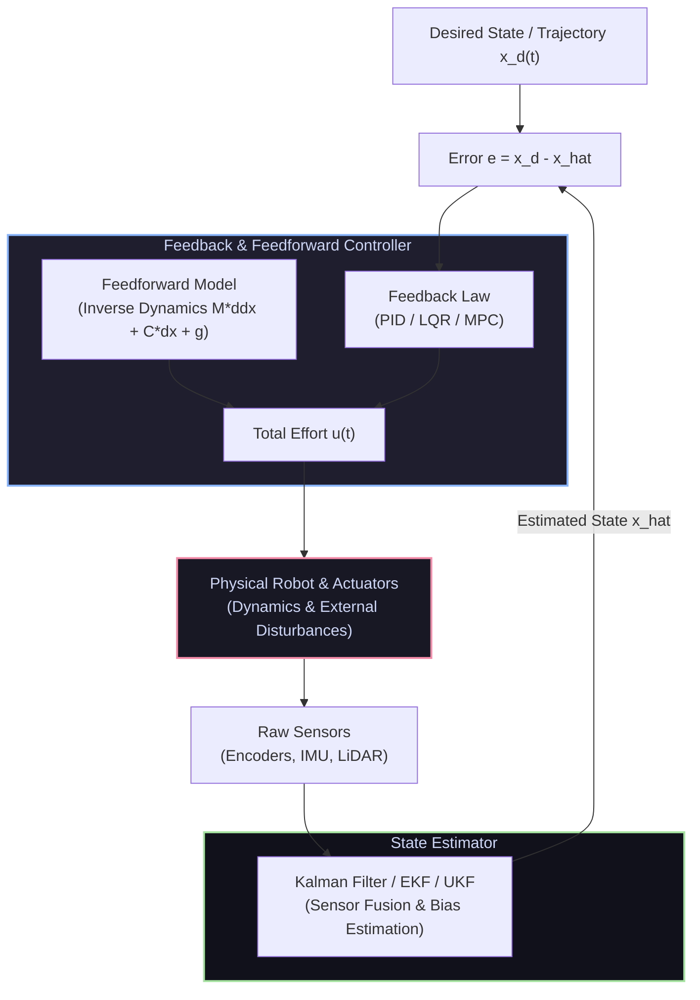

# 🎛️ Control Systems & State Estimation for Robotics

[ 🏠 Hub Home ](../README.md) &nbsp;•&nbsp; [ 🗺️ Full Roadmap ](../robotics-roadmap.md) &nbsp;•&nbsp; [ 📑 Math Formulas Cheat Sheet ](../cheatsheets/math-formulas-cheatsheet.md)

---

## 📌 Overview & Scope
Control theory is what allows a robot to execute commands smoothly and stably despite physical disturbances, uneven terrain, motor friction, payload changes, and sensor noise.

Modern robotics spans from decentralized joint-level PID loops up to multivariable **State-Space LQR**, **Model Predictive Control (MPC)**, and **Hierarchical Whole-Body Control (WBC)** executed on quadrupeds and humanoids at 1 kHz.

---

## 🔑 Core Control Paradigms

### 1. Classical PID Control & Real-World Fixes
The continuous PID equation:
$$u(t) = K_p e(t) + K_i \int_0^t e(\tau) d\tau + K_d \frac{de(t)}{dt}$$

* **Derivative Kick Prevention:** Differentiating error $\frac{d}{dt}(r(t) - y(t))$ causes violent spikes when the setpoint $r(t)$ steps discontinuously. Differentiate only the measured output: $-\frac{d}{dt}y(t)$.
* **Derivative Noise Filtering:** High-frequency encoder or IMU noise amplified by $K_d$ causes motor chattering. Pass the derivative term through a low-pass filter:
  $$D(s) = \frac{K_d s}{\frac{K_d}{N} s + 1}$$
* **Integrator Windup & Anti-Windup:** If a motor saturates at maximum voltage, the error continues integrating to infinity, causing huge overshoot when the obstacle clears. **Clamping Anti-Windup** halts integration the moment actuator limits are struck.
* **Feedforward Control:** Never rely solely on error feedback. Add feedforward gravitational torque $\boldsymbol{\tau}_{\text{ff}} = \mathbf{g}(\boldsymbol{\theta})$ so PID only needs to handle small unmodeled errors.

### 2. State-Space Representation & LQR
For linear(ized) continuous dynamical systems:
$$\dot{\mathbf{x}} = A\mathbf{x} + B\mathbf{u}, \quad \mathbf{y} = C\mathbf{x} + D\mathbf{u}$$

* **Linear Quadratic Regulator (LQR):** Finds the optimal state-feedback gain matrix $K$ that minimizes the infinite-horizon quadratic cost:
  $$J = \int_0^\infty \left( \mathbf{x}^T Q \mathbf{x} + \mathbf{u}^T R \mathbf{u} \right) dt$$
  * $Q \ge 0$: Penalizes state tracking deviations.
  * $R > 0$: Penalizes actuator effort / energy consumption.
  * The control law is simply:
    $$\mathbf{u} = -K \mathbf{x}$$
  * $K = R^{-1} B^T P$, where $P$ is solved via the **Continuous-Time Algebraic Riccati Equation (CARE)**:
    $$A^T P + P A - P B R^{-1} B^T P + Q = 0$$

### 3. Model Predictive Control (MPC)
MPC extends optimal control into finite receding horizons with **explicit constraints**:
$$\min_{\mathbf{u}_0, \dots, \mathbf{u}_{N-1}} \sum_{k=0}^{N-1} \left( \mathbf{x}_k^T Q \mathbf{x}_k + \mathbf{u}_k^T R \mathbf{u}_k \right) + \mathbf{x}_N^T Q_f \mathbf{x}_N$$
$$\text{subject to: } \mathbf{x}_{k+1} = f(\mathbf{x}_k, \mathbf{u}_k), \quad \mathbf{u}_{\min} \le \mathbf{u}_k \le \mathbf{u}_{\max}, \quad \mathbf{x}_{\min} \le \mathbf{x}_k \le \mathbf{x}_{\max}$$
* At each time step $t$, the controller solves this Quadratic Program (QP), applies the first input $\mathbf{u}_0$ to the motors, shifts the horizon by 1 step, and resolves at $t+1$.
* Enables dynamic obstacle avoidance, torque limits, and foot placement optimization for legged robots.

### 4. State Estimation: Kalman Filter (KF & EKF)
* **Linear Kalman Filter:** Optimal recursive data fusion algorithm under linear Gaussian assumptions.
  * **Prediction Step:**
    $$\hat{\mathbf{x}}_{k|k-1} = A \hat{\mathbf{x}}_{k-1|k-1} + B \mathbf{u}_k$$
    $$P_{k|k-1} = A P_{k-1|k-1} A^T + Q_k$$
  * **Update Step (Correction):**
    $$K_k = P_{k|k-1} C^T \left( C P_{k|k-1} C^T + R_k \right)^{-1}$$
    $$\hat{\mathbf{x}}_{k|k} = \hat{\mathbf{x}}_{k|k-1} + K_k \left( \mathbf{z}_k - C \hat{\mathbf{x}}_{k|k-1} \right)$$
    $$P_{k|k} = (I - K_k C) P_{k|k-1}$$
* **Extended Kalman Filter (EKF):** Computes Jacobians $F = \frac{\partial f}{\partial \mathbf{x}}$ and $H = \frac{\partial h}{\partial \mathbf{x}}$ at each step to linearize non-linear robotics dynamics.

---

## 🛠️ Industry Standard Control Toolkits

| Toolkit | Language | Core Specialty |
| :--- | :--- | :--- |
| **[CasADi](https://web.casadi.org/)** | Python / C++ / MATLAB | Algorithmic differentiation and non-linear optimization for MPC |
| **[acados](https://github.com/acados/acados)** | C / Python | Blazing-fast embedded SQP / QP solvers for microsecond real-time MPC |
| **[Python Control Systems Library](https://python-control.readthedocs.io/)** | Python | MATLAB-like syntax for Bode plots, root locus, state-space, and LQR |
| **[Robot Localization (ROS 2)](https://docs.ros.org/en/jazzy/p/robot_localization/)** | C++ | Out-of-the-box multi-sensor EKF/UKF fusion for wheel odometry and IMUs |

---

## 📚 Curated Learning Media

### 🎓 Premier Courses & Lectures
- [Steve Brunton: Control Bootcamp (YouTube)](https://www.youtube.com/playlist?list=PLMrJAkhIeNNSmDnDSMe9_wEnDk2cZ-dE4) — State-space, stability, LQR, observability, and Kalman filters.
- [Brian Douglas: Classical & Modern Control (YouTube)](https://www.youtube.com/user/ControlLectures) — Transfer functions, Bode plots, and PID intuitive tuning.
- [MIT 16.30: Feedback Control Systems (MIT OCW)](https://ocw.mit.edu/courses/16-30-feedback-control-systems-fall-2010/) — State-space design and linear quadratic Gaussian (LQG).
- [Underactuated Robotics (Prof. Russ Tedrake, MIT)](https://underactuated.csail.mit.edu/) — Advanced non-linear dynamics, MPC, and trajectory optimization.

### 📖 Essential Books
- *Modern Control Engineering* by Katsuhiko Ogata.
- *Feedback Control of Dynamic Systems* by Gene F. Franklin, J. David Powell, and Abbas Emami-Naeini.
- *Data-Driven Science and Engineering: Machine Learning, Dynamical Systems, and Control* by Steven L. Brunton and J. Nathan Kutz.
- *Optimal State Estimation* by Dan Simon.

---

[ ⬅️ Previous: Robotics Fundamentals ](../robotics_fundamentals/README.md) &nbsp;•&nbsp; [ Next: ROS 2 Ecosystem ➡️ ](../ros/README.md)

