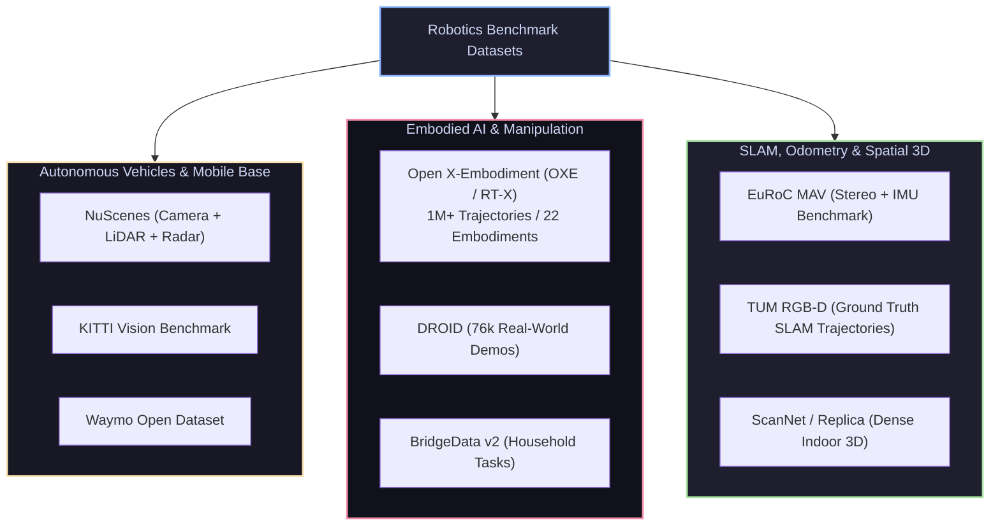

# 📊 Datasets & Benchmarks for Robotics & Embodied AI

[ 🏠 Hub Home ](../README.md) &nbsp;•&nbsp; [ 🗺️ Full Roadmap ](../robotics-roadmap.md) &nbsp;•&nbsp; [ 🔬 Landmark Papers ➡️ ](../research_papers/README.md)

---

## 📌 Overview & Scope
Training and validating robotic intelligence requires data that bridges visual perception, continuous action trajectories, sensor noise, and multi-modal interactions.

This directory catalogs the gold-standard datasets across **Autonomous Driving**, **Embodied AI & VLA Manipulation**, **Visual SLAM / LiDAR Odometry**, and **Indoor Spatial Reconstruction**.

---

## 🔑 Curated Benchmark Catalog

### 1. Embodied AI & Robotic Manipulation Datasets
* **[Open X-Embodiment (OXE / RT-X)](https://robotics-transformer-x.github.io/):**
  * *Scale:* **1,000,000+ demonstration trajectories** across 22 distinct robot embodiments (Google Robot, Franka Emika, ALOHA, WidowX, UR5).
  * *Modalities:* Multi-view RGB camera streams, joint state proprioception, language instructions, 7-DoF end-effector delta actions.
  * *Best Used For:* Pretraining generalist Vision-Language-Action (VLA) models such as OpenVLA and Octo.
* **[DROID (Distributed Robot Interaction Dataset)](https://droid-dataset.github.io/):**
  * *Scale:* 76,000 trajectory episodes collected across 564 diverse real-world environments (kitchens, offices, labs) using Franka Panda arms.
  * *Best Used For:* Training robust, out-of-distribution manipulation policies with high generalization.
* **[BridgeData v2](https://rail-berkeley.github.io/bridgedata/):**
  * *Scale:* 60,000+ demonstration episodes across 24 environments for everyday household pick-and-place tasks.
* **[DexNet 2.0 / 4.0 (Berkeley)](https://berkeleyautomation.github.io/dex-net/):**
  * *Scale:* 6.7 million 3D point clouds, synthetic depth images, and grasp robustness metrics.
  * *Best Used For:* Training parallel-jaw and suction grasp planners.

### 2. Autonomous Vehicles & Outdoor Mobile Robotics
* **[NuScenes (by Motional)](https://www.nuscenes.org/):**
  * *Setup:* 6 cameras, 5 radar sensors, 32-beam roof LiDAR, GPS/IMU with 360-degree coverage across Boston and Singapore.
  * *Best Used For:* Multi-modal 3D object detection, tracking, semantic segmentation, and BEV (Bird's Eye View) map generation.
* **[KITTI Vision Benchmark Suite](http://www.cvlibs.net/datasets/kitti/):**
  * *Setup:* Stereo cameras, Velodyne HDL-64E LiDAR, high-precision RTK GPS/INS.
  * *Best Used For:* Visual odometry benchmarks, stereo disparity evaluation, and 3D bounding box detection.
* **[Waymo Open Dataset](https://waymo.com/open/):**
  * *Setup:* Extremely dense 5 LiDARs, 5 high-res cameras with diverse weather conditions (rain, dusk, direct sun).

### 3. Visual Odometry & SLAM Benchmarks
* **[EuRoC MAV Dataset](https://projects.asl.ethz.ch/datasets/doku.php?id=kmav-visual-inertial-datasets):**
  * *Setup:* Micro-aerial vehicle flying through industrial rooms with stereo grayscale cameras (WVGA @ 20 FPS) and synchronized high-frequency ADIS16448 IMU (200 Hz). Includes millimeter ground-truth from Vicon motion capture.
  * *Best Used For:* Benchmarking Visual-Inertial Odometry (VIO) algorithms (VINS-Mono, ORB-SLAM3, OKVIS).
* **[TUM RGB-D Benchmark](https://vision.in.tum.de/data/datasets/rgbd-dataset):**
  * *Setup:* Microsoft Kinect RGB-D sensor recorded with OptiTrack ground truth.
  * *Best Used For:* Evaluating RGB-D SLAM trajectory drift (ATE - Absolute Trajectory Error, RPE - Relative Pose Error).

### 4. Dense 3D Indoor Reconstruction
* **[Replica Dataset](https://github.com/facebookresearch/Replica-Dataset):**
  * *Features:* 18 photorealistic, high-fidelity reconstructed 3D indoor scenes with dense mesh, HDR textures, and semantic classes.
  * *Best Used For:* Training NeRFs, 3D Gaussian Splatting SLAM (SplaTAM), and simulated navigation.
* **[ScanNet](http://www.scan-net.org/):**
  * *Features:* 2.5 million RGB-D frames across 1,513 indoor scenes annotated with 3D camera poses and surface reconstructions.

---

## 🛠️ Access & Ingestion Tooling

| Dataset | Python Access Library | Example Command |
| :--- | :--- | :--- |
| **Open X-Embodiment** | `tensorflow_datasets` / `rlds` | `import tensorflow_datasets as tfds; ds = tfds.load('bridge_dataset')` |
| **LeRobot Hub** | `huggingface/lerobot` | `from lerobot.common.datasets.lerobot_dataset import LeRobotDataset` |
| **NuScenes** | `nuscenes-devkit` | `from nuscenes.nuscenes import NuScenes; nusc = NuScenes(version='v1.0-mini')` |
| **Hugging Face Hub** | `datasets` | `from datasets import load_dataset` |

---

[ ⬅️ Previous: AI & Machine Learning ](../ai_ml/README.md) &nbsp;•&nbsp; [ Next: Landmark Research Papers ➡️ ](../research_papers/README.md)

