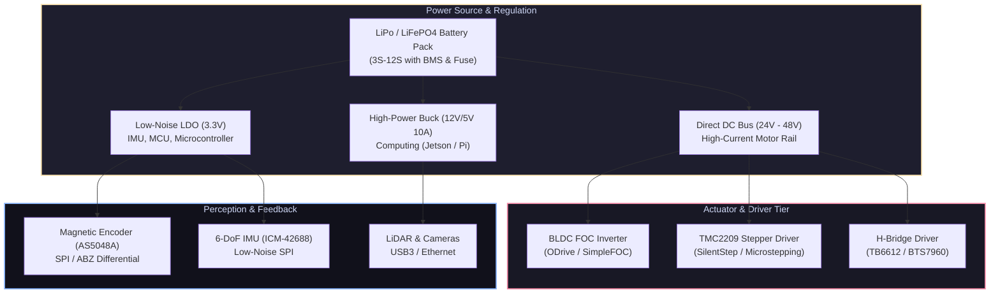

# ⚡ Electronics & Power Systems for Robotics

[ 🏠 Hub Home ](../README.md) &nbsp;•&nbsp; [ 🗺️ Full Roadmap ](../robotics-roadmap.md) &nbsp;•&nbsp; [ 📑 Pinout & Hardware Cheat Sheet ](../cheatsheets/hardware-and-pinouts.md)

---

## 📌 Overview & Scope
A robot's electrical infrastructure is its cardiovascular and circulatory system. High-performance software algorithms are useless if power supply ripple browns out the microcontroller, inductive motor kickback destroys the gate driver, or noisy grounds corrupt sensor readings.

This domain covers power distribution, high-discharge battery architectures, actuator drivers, motor control topology (H-bridge, BLDC FOC), electromagnetic interference (EMI) mitigation, and custom PCB engineering in KiCad.

---

## 🔑 Core Engineering Principles

### 1. Battery Power & Safety Engineering
* **Battery Chemistries:**
  * **LiPo (Lithium Polymer):** High energy density and massive discharge rates (30C–100C), essential for drones and dynamic legged robots. Fragile; susceptible to puncture, overcharging, and thermal runaway.
  * **LiFePO4 (Lithium Iron Phosphate):** Lower energy density, but chemically non-combustible, handles 2000+ charge cycles, ideal for industrial AMRs and warehouse rovers.
* **Cell Voltage Thresholds (LiPo):**
  * Maximum charged voltage: **4.20V / cell** (Never charge beyond 4.25V).
  * Nominal voltage: **3.70V / cell**.
  * Storage voltage: **3.85V / cell**.
  * Cutoff minimum voltage: **3.30V / cell** (Never discharge below 3.0V under load, or permanent internal resistance damage occurs).
* **Battery Management Systems (BMS):** A BMS is mandatory in all production robotics. It monitors individual cell voltages, implements passive cell balancing during charging, and cuts off load during overcurrent or under-voltage events.

### 2. Motor Drivers & Control Topologies
* **DC Motors (H-Bridge):** Four MOSFETs arranged in an "H" configuration. Switching diagonal pairs determines rotational direction; PWM duty cycle controls effective voltage and speed.
  * *Crucial Rule:* Always enforce a **dead-time** delay between switching upper and lower FETs on the same half-bridge to avoid catastrophic **shoot-through** (a direct dead short across power and ground).
* **Stepper Drivers (TMC2209 / TMC2130):** Utilize Trinamic microstepping interpolation to convert discrete 1.8° steps into 256 microsteps per full step, eliminating mechanical resonance and audible whining.
* **BLDC & PMSM Motors (Field-Oriented Control - FOC):**
  * Modern robotics manipulators and quadrupeds use 3-phase Brushless DC motors driven by FOC.
  * FOC measures phase currents (via inline or low-side shunts) and rotor angle (via magnetic encoder), transforms 3-phase currents ($a, b, c$) into a rotating orthogonal reference frame ($d, q$ axes via Clarke and Park transforms).
  * Driving the direct axis current $i_d = 0$ and controlling the quadrature axis current $i_q$ produces linear, ripple-free torque at maximum electrical efficiency.

### 3. Noise Mitigation, Grounding & Protection
* **Star Grounding:** Never daisy-chain motor power grounds through your microcontroller ground. Connect all high-current motor grounds and low-current digital grounds to a single physical point (the negative battery terminal or main power distribution board).
* **Decoupling & Bulk Capacitance:** Place low-ESR electrolytic capacitors (e.g., $470\mu\text{F} - 1000\mu\text{F}$) directly across motor driver voltage inputs to absorb current spikes. Place $0.1\mu\text{F}$ ceramic surface-mount capacitors within 3mm of every IC power pin to suppress high-frequency switching noise.
* **Regenerative Braking Protection:** When brushless motors decelerate rapidly, back-EMF acts as a generator, pumping energy back into the DC bus. Use TVS diodes or active brake resistors with comparator circuits to dump excess voltage and protect electronics.

---

## 🛠️ Industry Standard Electrical Tools

| Tool / Software | Role | Why It Is The Industry Standard |
| :--- | :--- | :--- |
| **[KiCad 8](https://www.kicad.org/)** | PCB Design & EDA | Fully open-source, highly capable schematic capture and multi-layer layout with 3D viewer |
| **[LTspice](https://www.analog.com/en/resources/design-tools-and-calculators/ltspice-simulator.html)** | SPICE Circuit Simulation | Rapid modeling of power supplies, filters, and transient behavior before prototyping |
| **[SimpleFOC](https://simplefoc.com/)** | Embedded FOC Library | Open-source FOC algorithm implementation for Arduino, STM32, and ESP32 |
| **[ODrive](https://odriverobotics.com/)** | High-Power BLDC Controller | Production-grade dual-motor FOC controller with CAN, USB, and high-resolution encoder support |
| **Digital Oscilloscope** | Laboratory Hardware | Inspecting PWM square waves, SPI clock jitter, CAN bus differential signal reflections |

---

## 📚 Curated Learning Media

### 🎓 Premier Courses & Lectures
- [MIT 6.002: Circuits and Electronics (MIT OCW)](https://ocw.mit.edu/courses/6-002-circuits-and-electronics-spring-2007/) — Core network theorems and circuit design.
- [Introduction to Electronics (Georgia Tech / Coursera)](https://www.coursera.org/learn/electronics) — Operational amplifiers, diodes, and transistors.
- [Phil's Lab: KiCad PCB Design Tutorials (YouTube)](https://www.youtube.com/@PhilsLab) — High-speed digital and power electronics PCB design from schematic to fab.

### 📖 Essential Books
- *The Art of Electronics (3rd Edition)* by Paul Horowitz and Winfield Hill — The undisputed bible of practical electronics engineering.
- *Practical Electronics for Inventors* by Paul Scherz and Simon Monk — Accessible explanations of real components and sensor interfacing.
- *Power Electronics: Converters, Applications, and Design* by Ned Mohan — Switching converters and motor drives.

### 🎥 High-Yield Video Channels
- [EEVblog (YouTube)](https://www.youtube.com/@EEVblog) — Hands-on electronics debugging, teardowns, and design pitfalls.
- [GreatScott! (YouTube)](https://www.youtube.com/@greatscottlab) — Practical maker-level circuit tutorials, battery builds, and motor tests.
- [DroneBot Workshop (YouTube)](https://www.youtube.com/@Dronebotworkshop1) — Interfacing sensors, motor drivers, and microcontrollers.

---

[ ⬅️ Previous: Mathematics ](../mathematics/README.md) &nbsp;•&nbsp; [ Next: Embedded Systems ➡️ ](../embedded_systems/README.md)

