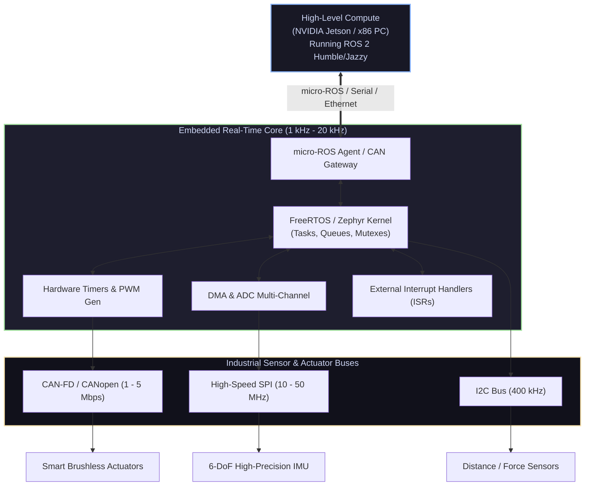

# 📟 Embedded Systems & Microcontrollers for Robotics

<div align="center">

[ 🏠 Hub Home ](../README.md) &nbsp;•&nbsp; [ 🗺️ Full Roadmap ](../robotics-roadmap.md) &nbsp;•&nbsp; [ 📑 Hardware & Pinouts Cheat Sheet ](../cheatsheets/hardware-and-pinouts.md)

</div>

---

## 📌 Overview & Scope
The embedded tier serves as the bridge between software logic running on Single Board Computers (NVIDIA Jetson, Raspberry Pi 5, x86 PC) and the physical actuators and sensors.

While high-level algorithms plan trajectories in milliseconds, the embedded firmware executes **hard real-time** loops in microseconds (1 kHz – 20 kHz): reading optical/magnetic encoders, servicing hardware interrupts, executing Field-Oriented Control (FOC), and broadcasting safety-critical telemetries over **CAN-FD** or **micro-ROS**.



---

## 🔑 Core Technical Concepts

### 1. Silicon Hardware Comparison for Robotics

| Platform | Core Architecture | Clock Speed | Key Strength for Robotics |
| :--- | :--- | :--- | :--- |
| **STM32 (G4 / H7)** | ARM Cortex-M4 / M7 with FPU | 170 MHz – 480 MHz | Dedicated motor control timers (HRTIM), CAN-FD, analog comparators |
| **ESP32-S3** | Dual-Core Xtensa LX7 | 240 MHz | Built-in Wi-Fi & BLE 5, native USB-OTG, dual-core task segregation |
| **Teensy 4.1** | NXP i.MX RT1062 (Cortex-M7) | 600 MHz | Massive processing power, 3x CAN buses, native 100Mbps Ethernet |
| **RP2040 / RP2350** | Dual Cortex-M0+ / M33 | 133 MHz – 150 MHz | **PIO (Programmable I/O)**: builds custom state machines for stepper/quadrature |

### 2. Embedded Communication Protocols in Robotics

```
Protocol   Wires   Duplex   Speed         Topology       Best Use in Robotics
─────────────────────────────────────────────────────────────────────────────
UART       2-3     Full     Up to 3 Mbps  Point-to-Point GPS, Telemetry radios, SBC bridge
SPI        4       Full     10 - 50 Mbps  Master-Slave   IMU sensors, Flash memory, Encoders
I2C        2       Half     100k - 1 Mbps Multi-drop     Environmental sensors, OLED displays
CAN Bus    2       Half     1 - 5 Mbps    Multi-Master   Actuators, Battery BMS, Robot joints
```

* **CAN Bus (Controller Area Network) Deep-Dive:**
  * CAN is the gold-standard protocol for robotics manipulation joints and mobile platforms.
  * **Differential Signaling:** Uses two lines, `CAN_H` and `CAN_L`. Noise picked up on the twisted pair impacts both wires equally, canceling out at the receiver.
  * **Termination:** Requires a **120 $\Omega$ resistor** at each extreme physical end of the bus between `CAN_H` and `CAN_L` to eliminate signal reflections.
  * **Arbitration:** Non-destructive bitwise arbitration. Every message has an Identifier (11-bit standard or 29-bit extended). If two nodes transmit simultaneously, the message with the lower numerical ID (dominant zeros) wins the bus with zero collision delay.

### 3. Real-Time Operating Systems (RTOS)
* **Preemptive Priority Scheduling:** Unlike an Arduino super-loop (`void loop()`), an RTOS assigns strict priority to tasks. If an emergency e-stop or motor fault interrupt fires, the RTOS preempts lower-priority telemetry tasks instantly.
* **Priority Inversion & Inheritance:** If a low-priority task holds a mutex lock needed by a high-priority task, and a medium-priority task runs, the high-priority task is starved. Modern RTOSes implement **Priority Inheritance** to temporarily boost the low-priority task's priority until the lock is freed.
* **FreeRTOS Primitives:**
  * `xTaskCreatePinnedToCore()`: Pin tasks to distinct physical silicon cores.
  * `xQueueSend()` / `xQueueReceive()`: Thread-safe FIFO data passing between ISRs and processing tasks.
  * `vTaskDelayUntil()`: Deterministic periodic loop scheduling without time drift.

### 4. micro-ROS: ROS 2 on the Edge
* Allows microcontrollers (STM32, ESP32, Teensy) to act as first-class citizens in the ROS 2 computational graph.
* Microcontrollers run the lightweight **micro-XRCE-DDS Client**, which communicates with a **micro-ROS Agent** running on the SBC over serial UART, USB, or UDP.
* The microcontroller directly publishes topics (e.g., `/joint_states`, `/imu/data_raw`) and subscribes to velocity commands (`/cmd_vel`) without writing custom serial parsers.

---

## 🛠️ Industry Standard Toolchains

| Tool | Category | Purpose |
| :--- | :--- | :--- |
| **[STM32CubeIDE / HAL](https://www.st.com/en/development-tools/stm32cubeide.html)** | IDE & SDK | Official development suite, clock tree configurator, and HAL drivers for STM32 |
| **[ESP-IDF](https://docs.espressif.com/projects/esp-idf/en/latest/esp32/)** | SDK & Framework | Espressif IoT Development Framework for industrial ESP32 development |
| **[PlatformIO](https://platformio.org/)** | Cross-Platform Tooling | Modern VS Code extension for building, compiling, and debugging embedded firmware |
| **[micro-ROS](https://micro.ros.org/)** | Middleware | Official framework putting ROS 2 directly on microcontrollers |
| **[Saleae Logic Analyzer](https://www.saleae.com/)** | Hardware Debugger | Inspecting and decoding SPI, I2C, CAN, and UART packets directly on wires |

---

## 📚 Curated Learning Media

### 🎓 Premier Courses & Lectures
- [EdX: Embedded Systems - Shape the World (UT Austin)](https://www.edx.org/course/embedded-systems-shape-the-world-microcontroller) — Taught by Valvano & Yerraballi using ARM Cortex-M.
- [FastBit Embedded Brain Academy (YouTube / Udemy)](https://www.youtube.com/@FastbitEmbeddedBrainAcademy) — Deep dives into ARM Cortex-M processors, bare-metal C, and FreeRTOS.
- [Digi-Key Introduction to RTOS (YouTube Series by Shawn Hymel)](https://www.youtube.com/playlist?list=PLEBQazB0HUyQ4RAP3FlKCujLcrnyN654b) — The clearest visual introduction to FreeRTOS concepts.

### 📖 Essential Books
- *Making Embedded Systems* by Elecia White — Architecture patterns for embedded software engineers.
- *Mastering STM32* by Carmine Noviello — Step-by-step programming of STM32 microcontrollers using the HAL and FreeRTOS.
- *Real-Time Concepts for Embedded Systems* by Qing Li and Caroline Yao.
- *The Definitive Guide to ARM Cortex-M3 and Cortex-M4 Processors* by Joseph Yiu.

### 💻 Open-Source Repositories
- [micro-ROS/micro_ros_arduino](https://github.com/micro-ROS/micro_ros_arduino) — Precompiled micro-ROS libraries for Arduino-compatible platforms.
- [espressif/esp-idf](https://github.com/espressif/esp-idf) — Core development framework for ESP32.
- [FreeRTOS/FreeRTOS-Kernel](https://github.com/FreeRTOS/FreeRTOS-Kernel) — Core FreeRTOS kernel source code.

---

<div align="center">

[ ⬅️ Previous: Electronics ](../electronics/README.md) &nbsp;•&nbsp; [ Next: Mechanical Design ➡️ ](../mechanical_design/README.md)

</div>
