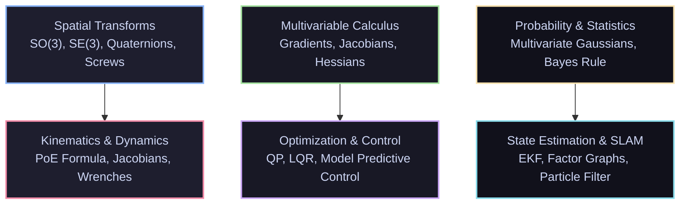

# 📐 Mathematics for Robotics

[ 🏠 Hub Home ](../README.md) &nbsp;•&nbsp; [ 🗺️ Full Roadmap ](../robotics-roadmap.md) &nbsp;•&nbsp; [ 📑 Math Formulas Cheat Sheet ](../cheatsheets/math-formulas-cheatsheet.md)

---

## 📌 Overview & Scope
Robotics is applied spatial mathematics. Without rigorous mathematical modeling, robots cannot know where they are, how their joints relate to their fingertips, or how to avoid tipping over under momentum. 

Modern robotics has graduated beyond standard introductory calculus into **Lie Groups ($SO(3), SE(3)$)**, **Screw Theory**, **Nonlinear Optimization (Quadratic Programming)**, and **Bayesian Estimation**.

---

## 🔑 Core Mathematical Foundations

### 1. Spatial Rotations & $SO(3)$
A 3D rotation belongs to the Special Orthogonal Group:
$$SO(3) = \{ R \in \mathbb{R}^{3 \times 3} \mid R^T R = I, \; \det(R) = +1 \}$$

* **Euler Angles:** Intuitive (Roll, Pitch, Yaw), but suffer from **Gimbal Lock** (loss of 1 degree of freedom when pitch reaches $\pm 90^\circ$).
* **Unit Quaternions:** Represented as $q = (w, x, y, z) = (\cos\frac{\theta}{2}, \mathbf{u}\sin\frac{\theta}{2})$ with $\|q\| = 1$. Completely immune to gimbal lock, computationally compact (4 floats vs 9 in a matrix), and trivial to interpolate via **SLERP** (Spherical Linear Interpolation).
* **Lie Algebra $\mathfrak{so}(3)$:** The tangent space at identity. Represents angular velocities as skew-symmetric matrices:
  $$[\boldsymbol{\omega}]_\times = \begin{bmatrix} 0 & -\omega_z & \omega_y \\ \omega_z & 0 & -\omega_x \\ -\omega_y & \omega_x & 0 \end{bmatrix}$$
  The **exponential map** converts an axis-angle vector $\boldsymbol{\omega}\theta$ into an $SO(3)$ rotation matrix using **Rodrigues' Formula**:
  $$\exp([\boldsymbol{\omega}]_\times \theta) = I + \sin\theta [\boldsymbol{\omega}]_\times + (1 - \cos\theta) [\boldsymbol{\omega}]_\times^2$$

### 2. Rigid Body Motions & $SE(3)$
The Special Euclidean Group combines 3D rotation and translation:
$$SE(3) = \left\{ T = \begin{bmatrix} R & \mathbf{p} \\ \mathbf{0}_{1 \times 3} & 1 \end{bmatrix} \in \mathbb{R}^{4 \times 4} \;\middle|\; R \in SO(3), \; \mathbf{p} \in \mathbb{R}^3 \right\}$$
* **Inverting a Transformation:** Do NOT use general Gaussian elimination inversion. Take advantage of structure:
  $$T^{-1} = \begin{bmatrix} R^T & -R^T \mathbf{p} \\ \mathbf{0} & 1 \end{bmatrix}$$
* **Twists & Wrenches:** 
  * A spatial **Twist** $\mathcal{V} = \begin{bmatrix} \boldsymbol{\omega} \\ \mathbf{v} \end{bmatrix} \in \mathbb{R}^6$ packages angular velocity $\boldsymbol{\omega}$ and linear velocity $\mathbf{v}$.
  * A spatial **Wrench** $\mathcal{F} = \begin{bmatrix} \mathbf{m} \\ \mathbf{f} \end{bmatrix} \in \mathbb{R}^6$ packages moments/torques $\mathbf{m}$ and forces $\mathbf{f}$.
* **Product of Exponentials (PoE) Formula:** Modern replacement for DH-parameters:
  $$T(\theta) = e^{[\mathcal{S}_1]\theta_1} e^{[\mathcal{S}_2]\theta_2} \cdots e^{[\mathcal{S}_n]\theta_n} M$$
  where $\mathcal{S}_i$ are the screw axes in the base frame and $M$ is the home configuration matrix.

### 3. Optimization & Solvers
Robotics problems (inverse kinematics, model predictive control, loop closure in SLAM) are fundamentally non-linear optimization problems:
$$\min_{\mathbf{x}} f(\mathbf{x}) \quad \text{subject to } g(\mathbf{x}) \le 0, \; h(\mathbf{x}) = 0$$

* **Quadratic Programming (QP):** Quadratic objective with linear constraints. Solved in sub-milliseconds, enabling 1 kHz Whole-Body Control on quadruped/humanoid robots.
* **Levenberg-Marquardt (LM):** Interpolates between Gauss-Newton and gradient descent to solve non-linear least squares in bundle adjustment and SLAM.
* **Solvers to Know:** [OSQP](https://osqp.org/), [qpOASES](https://github.com/coin-or/qpOASES), [CasADi](https://web.casadi.org/), [Ceres Solver](http://ceres-solver.org/).

### 4. Bayesian Probability & Gaussian Distributions
* **Multivariate Gaussian:** Defined by mean vector $\boldsymbol{\mu} \in \mathbb{R}^n$ and symmetric positive semi-definite covariance matrix $\boldsymbol{\Sigma} \in \mathbb{R}^{n \times n}$:
  $$p(\mathbf{x}) = \frac{1}{\sqrt{(2\pi)^n \det(\boldsymbol{\Sigma})}} \exp\left( -\frac{1}{2} (\mathbf{x} - \boldsymbol{\mu})^T \boldsymbol{\Sigma}^{-1} (\mathbf{x} - \boldsymbol{\mu}) \right)$$
* **Linear Transformation Theorem:** If $\mathbf{y} = A\mathbf{x} + \mathbf{b}$ and $\mathbf{x} \sim \mathcal{N}(\boldsymbol{\mu}, \boldsymbol{\Sigma})$, then:
  $$\mathbf{y} \sim \mathcal{N}(A\boldsymbol{\mu} + \mathbf{b}, \; A\boldsymbol{\Sigma} A^T)$$
  This single identity is the mathematical heartbeat of the Kalman Filter.

---

## 📚 Curated Learning Media

### 🎓 Premier University Courses
- [MIT 18.06: Linear Algebra (Prof. Gilbert Strang)](https://ocw.mit.edu/courses/18-06-linear-algebra-spring-2010/) — The definitive world-famous linear algebra lectures.
- [Stanford EE263: Introduction to Linear Dynamical Systems (Prof. Stephen Boyd)](https://see.stanford.edu/Course/EE263) — State-space, SVD, least-squares.
- [Stanford EE364a: Convex Optimization (Prof. Stephen Boyd)](https://see.stanford.edu/Course/EE364A) — The industry bible for mathematical optimization.
- [Modern Robotics: Mechanics, Planning, and Control (Northwestern / Coursera)](http://modernrobotics.org/) — Kevin Lynch & Frank Park.

### 📖 Essential Textbooks
- *Modern Robotics: Mechanics, Planning, and Control* by Kevin M. Lynch and Frank C. Park (Free online PDF available).
- *Convex Optimization* by Stephen Boyd and Lieven Vandenberghe (Free PDF available).
- *Probabilistic Robotics* by Sebastian Thrun, Wolfram Burgard, and Dieter Fox.
- *State Estimation for Robotics* by Timothy D. Barfoot (Comprehensive Lie groups & Kalman filtering manual).

### 🎥 High-Yield Video Channels
- [3Blue1Brown: Essence of Linear Algebra (YouTube)](https://www.youtube.com/playlist?list=PLZHQObOWTQDPD3MizzM2xVFitgF8hE_ab) — Unmatched visual intuition for matrices and vectors.
- [3Blue1Brown: Essence of Calculus (YouTube)](https://www.youtube.com/playlist?list=PLZHQObOWTQDMsr9K-rj53DwVRMYO3t5Yr) — Visual derivatives and integrals.
- [Steve Brunton: Data-Driven Science & Control (YouTube)](https://www.youtube.com/@Eigensteve) — SVD, dynamical systems, and PCA.

### 💻 Open-Source Repositories
- [NxRLab/ModernRobotics](https://github.com/NxRLab/ModernRobotics) — Official code library for the Modern Robotics textbook (Python, C++, MATLAB).
- [ceres-solver/ceres-solver](https://github.com/ceres-solver/ceres-solver) — High performance C++ library for modeling and solving large non-linear least squares problems.
- [libeigen/eigen](https://gitlab.com/libeigen/eigen) — C++ template library for linear algebra.

---

[ ⬅️ Previous: Programming & Linux ](../programming/README.md) &nbsp;•&nbsp; [ Next: Electronics & Power ➡️ ](../electronics/README.md)

