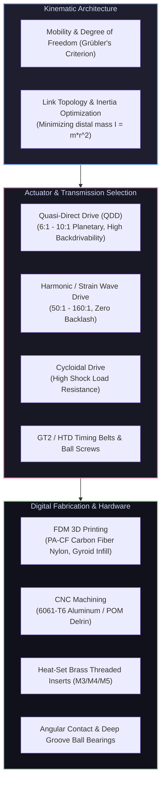

# ⚙️ Mechanical Design & Actuation for Robotics

<div align="center">

[ 🏠 Hub Home ](../README.md) &nbsp;•&nbsp; [ 🗺️ Full Roadmap ](../robotics-roadmap.md) &nbsp;•&nbsp; [ 🦾 Robotics Fundamentals ➡️ ](../robotics_fundamentals/README.md)

</div>

---

## 📌 Overview & Scope
A robot's mechanical structure dictates its physical capabilities, payload limit, speed, energy efficiency, and dynamic compliance. No software controller can compensate for excessive joint backlash, structural torsional flex, or underpowered, overheated motors.

This domain covers parametric 3D CAD, actuator selection and sizing, gear transmission mechanics (Planetary, Harmonic, Cycloidal, QDD), digital fabrication (3D printing with Carbon-Fiber Nylon, CNC aluminum), and structural rigidity.



---

## 🔑 Core Engineering Principles

### 1. Actuator Paradigms: High-Ratio vs Quasi-Direct Drive (QDD)

```
Drive Type           Gear Ratio   Backdrivable   Reflected Inertia   Primary Application
──────────────────────────────────────────────────────────────────────────────────────────
Direct Drive         1:1          Complete       Extremely Low       High-speed delta robots
Quasi-Direct (QDD)   6:1 – 10:1   High           Low                 Quadrupeds, Humanoids
Planetary Gearbox    10:1 – 40:1  Moderate       Medium              Mobile wheel drives
Harmonic Drive       50:1 – 160:1 Near-Zero      Very High ($N^2$)   Precision industrial arms
Cycloidal Drive      20:1 – 80:1  Low            High                Heavy-payload robotics
```

* **The Law of Reflected Inertia:** When a motor with rotor inertia $I_m$ is geared through a ratio $N$, the effective inertia reflected to the robot joint scales with the square of the gear ratio:
  $$I_{\text{reflected}} = N^2 I_m$$
  * A 100:1 Harmonic drive increases reflected inertia by a factor of **10,000**, making the arm stiff, non-compliant, and vulnerable to impact shocks.
  * A 6:1 QDD actuator reflects only **36x** rotor inertia, enabling the actuator to sense external collisions via motor current and absorb impacts safely.

### 2. Motor Sizing & Thermal Duty Cycle
When sizing a motor for a robotic arm or wheeled base:
1. **Continuous Stall Torque ($T_{\text{cont}}$):** The maximum torque the motor can output continuously without winding insulation melting ($T_{\text{temp}} < 100^\circ\text{C}$). Must exceed the static gravitational hold torque.
2. **Peak Acceleration Torque ($T_{\text{peak}}$):** Required during transient bursts to accelerate joint inertia:
   $$T_{\text{req}} = T_{\text{gravity}} + I_{\text{total}} \cdot \alpha$$
3. **RMS Torque ($T_{\text{rms}}$):** Root Mean Square of torque over the expected motion cycle must not exceed the continuous motor rating:
   $$T_{\text{rms}} = \sqrt{\frac{1}{t_{\text{total}}} \sum_{i} T_i^2 \Delta t_i} \le T_{\text{continuous}}$$

### 3. Digital Fabrication for Robotics
* **FDM 3D Printing Rules:**
  * **Material Selection:** Use **PETG** for general structural frames (superior impact resistance over brittle PLA). Use **PA-CF (Nylon filled with chopped Carbon Fiber)** for stiff actuator mounts, gears, and robot arm links.
  * **Wall Perimeters over Infill:** Bending stiffness is governed by surface outer fibers. 5–6 perimeters with 30% gyroid infill produces a substantially stronger part than 2 perimeters with 80% infill, while weighing less.
  * **Threaded Fastening:** Never screw bolts directly into raw 3D-printed plastic threads. Always design tapered counterbores and press in **brass heat-set threaded inserts** with a soldering iron.

---

## 🛠️ Industry Standard CAD & Mechanical Tools

| Tool / Software | Role | Why It Is The Industry Standard |
| :--- | :--- | :--- |
| **[Autodesk Fusion 360](https://www.autodesk.com/products/fusion-360/)** | Parametric CAD & CAM | Free for hobbyists/students, integrated cloud parametric modeling, stress FEA, and toolpath generation |
| **[Onshape](https://www.onshape.com/)** | Cloud CAD | Full browser-based collaborative CAD with versioning and git-like branching |
| **[SolidWorks](https://www.solidworks.com/)** | Professional CAD | Industry standard across aerospace and enterprise robotics manufacturers |
| **[McMaster-Carr](https://www.mcmaster.com/)** | Hardware Catalog | The universal repository of standard CAD models for bearings, fasteners, gears, and extrusions |
| **[Bambu Studio / PrusaSlicer](https://bambulab.com/en/download/studio)** | FDM Slicers | Modern slicing software with adaptive layers, organic tree supports, and multi-material presets |

---

## 📚 Curated Learning Media

### 🎓 Premier Courses & Lectures
- [Coursera: 3D CAD Fundamental (National Taiwan University)](https://www.coursera.org/learn/3d-cad-fundamental) — Core parametric modeling principles.
- [edX: Robotics: Kinematics and Mathematical Foundations (Penn)](https://www.edx.org/course/robotics-kinematics-and-mathematical-foundations) — Mechanical degrees of freedom and spatial linkage design.
- [Product Design Online: Fusion 360 Tutorials (YouTube)](https://www.youtube.com/@ProductDesignOnline) — Complete beginner to advanced 3D modeling walkthroughs.

### 📖 Essential Books
- *Shigley's Mechanical Engineering Design* by Richard Budynas and Keith Nisbett — The gold standard for mechanical stress, fatigue, bearings, and gears.
- *Robot Mechanisms and Mechanical Devices Illustrated* by Paul Sandin — Visual reference catalog of mechanical linkages, grippers, and drives.
- *Modern Robotics: Mechanics, Planning, and Control* by Kevin M. Lynch and Frank C. Park — Chapters on open/closed kinematic chains.

### 🎥 High-Yield Video Channels
- [Jeremy Fielding (YouTube)](https://www.youtube.com/@JeremyFieldingSr) — Incredible tutorials on choosing motors, bearings, gear ratios, and building physical mechanisms.
- [Skyentific (YouTube)](https://www.youtube.com/@Skyentific) — Engineering analyses of robotic arms, cycloidal drives, and Harmonic gearboxes.
- [How To Mechatronics (YouTube)](https://www.youtube.com/@HowToMechatronics) — Practical 3D printed robot arm and quadruped builds.

---

<div align="center">

[ ⬅️ Previous: Embedded Systems ](../embedded_systems/README.md) &nbsp;•&nbsp; [ Next: Robotics Fundamentals ➡️ ](../robotics_fundamentals/README.md)

</div>
