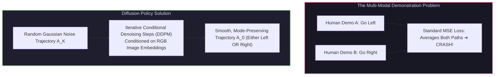

# 📄 Diffusion Policy: Visuomotor Policy Learning via Action Diffusion

[ ⬅️ Back to Papers Index ](README.md) &nbsp;•&nbsp; [ 🏠 Hub Home ](../README.md)

---

## 📌 Metadata
* **Authors:** Cheng Chi, Siyuan Feng, Yilun Du, Zhenjia Xu, Eric Cousineau, Benjamin Burchfiel, Shuran Song
* **Institutions:** Columbia University, MIT, Stanford, Toyota Research Institute (TRI)
* **Venue:** Robotics: Science and Systems (RSS 2023) / International Journal of Robotics Research (IJRR 2024)
* **Paper Link:** [arXiv:2303.04137](https://arxiv.org/abs/2303.04137)
* **Official Code:** [real-stanford/diffusion_policy](https://github.com/real-stanford/diffusion_policy)
* **Core Contribution:** Introduced **Diffusion Policy**, representing a robot's visuomotor policy as a conditional denoising diffusion process over continuous action spaces. Demonstrated that diffusion policies consistently outperform standard explicit policies (MLPs, Transformers) across complex bimanual manipulation benchmarks.

---

## 🔑 Why Standard Visuomotor Policies Fail: Multi-Modality

In real-world robotic teleoperation, human demonstrations are inherently **multimodal**:
* When a human operator encounters an obstacle, they might maneuver left on trial 1, or maneuver right on trial 2.
* An explicit policy parameterized by a Gaussian MLP minimizes Mean Squared Error (MSE), predicting the mathematical mean between going left and going right:
  $$\hat{\mathbf{a}} = \frac{\mathbf{a}_{\text{left}} + \mathbf{a}_{\text{right}}}{2} \Longrightarrow \text{CRASH INTO THE OBSTACLE!}$$
* Implicit models (Energy-Based Models / EBMs) handle multimodality, but suffer from training instability and slow sampling.

---

## 🔑 Mathematical Formulation: Denoising Diffusion Probabilistic Models (DDPM)

Diffusion Policy represents the action trajectory $\mathbf{A}_0 \in \mathbb{R}^{T_a \times D_a}$ conditioned on visual observation history $\mathbf{O}_t \in \mathbb{R}^{T_o \times D_o}$.

### 1. Forward Noising Process (Fixed Markov Chain)
Adds incremental Gaussian noise over $K$ diffusion steps:
$$q(\mathbf{A}_k \mid \mathbf{A}_{k-1}) = \mathcal{N}\left( \mathbf{A}_k; \sqrt{1 - \beta_k}\mathbf{A}_{k-1}, \beta_k I \right)$$
At step $K$, $\mathbf{A}_K$ is indistinguishable from standard isotropic Gaussian noise $\mathcal{N}(0, I)$.

### 2. Reverse Denoising Process (Learned Neural Network)
A noise-prediction neural network $\boldsymbol{\epsilon}_\theta(\mathbf{A}_k, k, \mathbf{O}_t)$ predicts the added noise:
$$\mathcal{L}(\theta) = \mathbb{E}_{k, \mathbf{A}_0, \boldsymbol{\epsilon}}\left[ \| \boldsymbol{\epsilon} - \boldsymbol{\epsilon}_\theta(\mathbf{A}_k, k, \mathbf{O}_t) \|^2 \right]$$

### 3. Action Chunking & Receding Horizon
* The model predicts an action trajectory spanning $T_a = 16$ future steps.
* The robot executes only the first $T_e = 8$ steps before querying a new diffusion prediction, blending receding-horizon control with high reactivity.

---

## 🦾 Real-World Impact
* **Benchmark Results:** Achieved an average **46.9% absolute increase in task success rate** across 11 diverse physical tasks compared to standard BC baselines.
* **Adoption:** Became the foundational manipulation policy architecture integrated directly into **Hugging Face LeRobot**, Stanford ALOHA, and modern commercial humanoid platforms.
