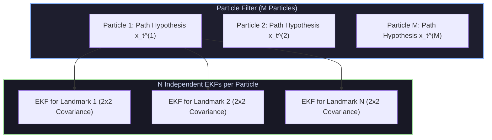

# 📄 FastSLAM: A Factored Solution to Simultaneous Localization and Mapping

[ ⬅️ Back to Papers Index ](README.md) &nbsp;•&nbsp; [ 🏠 Hub Home ](../README.md)

---

## 📌 Metadata
* **Authors:** Michael Montemerlo, Sebastian Thrun, Daphne Koller, Ben Wegbreit (Stanford / CMU)
* **Publication:** AAAI National Conference on Artificial Intelligence (2002)
* **Paper Link:** [AAAI Digital Library](https://www.aaai.org/Papers/AAAI/2002/AAAI02-089.pdf)
* **Core Contribution:** Introduced **Rao-Blackwellized Particle Filtering** to SLAM, reducing the computational complexity of landmark-based SLAM from $O(N^2)$ in classical EKF-SLAM to $O(M \log N)$, where $M$ is the number of particles and $N$ is the number of landmarks.

---

## 🔑 Mathematical Derivation & Factoring

In the full SLAM problem, the goal is to estimate the posterior distribution over the robot's entire trajectory $x_{1:t}$ and the map of $N$ landmarks $m = \{m_1, \dots, m_N\}$ conditioned on controls $u_{1:t}$ and observations $z_{1:t}$:
$$p(x_{1:t}, m \mid z_{1:t}, u_{1:t})$$

### The Rao-Blackwellization Insight
The authors proved that if the true robot path $x_{1:t}$ is known, the errors in estimating different landmarks become **conditionally independent**. Therefore, the joint distribution factors exactly:
$$p(x_{1:t}, m \mid z_{1:t}, u_{1:t}) = p(x_{1:t} \mid z_{1:t}, u_{1:t}) \prod_{n=1}^N p(m_n \mid x_{1:t}, z_{1:t})$$

1. **Path Posterior $p(x_{1:t} \mid z_{1:t}, u_{1:t})$:** Sampled using a **Particle Filter** with $M$ particles. Each particle represents a candidate trajectory history.
2. **Landmark Estimates $p(m_n \mid x_{1:t}, z_{1:t})$:** Estimated analytically using $N$ independent, low-dimensional **Extended Kalman Filters (EKFs)** attached to each particle.

---

## ⚡ Algorithmic Execution Steps
For each particle $k \in \{1, \dots, M\}$ at time step $t$:
1. **Sample Robot Pose:** Draw candidate pose $x_t^{[k]} \sim p(x_t \mid x_{t-1}^{[k]}, u_t)$ from the motion model.
2. **Update Landmark EKF:** For each observed feature $j$, compute the innovation (measurement residual) and update the 2D/3D mean $\mu_{j, t}^{[k]}$ and covariance $\Sigma_{j, t}^{[k]}$ using standard EKF equations.
3. **Calculate Importance Weight ($w_t^{[k]}$):** Weight each particle by the measurement likelihood:
   $$w_t^{[k]} = \frac{1}{\sqrt{|2\pi Q_t|}} \exp\left( -\frac{1}{2} (z_t - \hat{z}_t^{[k]})^T Q_t^{-1} (z_t - \hat{z}_t^{[k]}) \right)$$
4. **Resampling:** When the effective number of particles $N_{\text{eff}} = \frac{1}{\sum (w_t^{[k]})^2}$ drops below threshold, resample with replacement using low-variance systematic resampling.

---

## 🦾 Impact on Modern Robotics
* **FastSLAM 2.0 (2003):** Improved the proposal distribution by incorporating the most recent measurement $z_t$ during sampling, drastically reducing particle depletion.
* **Gmapping:** The canonical 2D laser SLAM package used worldwide in ROS for over a decade was a direct Rao-Blackwellized grid-mapping derivative of FastSLAM.
