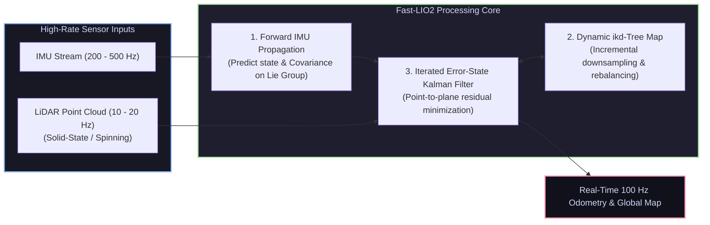

# 📄 Fast-LIO2: Fast Direct LiDAR-Inertial Odometry via Incremental kd-Tree

[ ⬅️ Back to Papers Index ](README.md) &nbsp;•&nbsp; [ 🏠 Hub Home ](../README.md)

---

## 📌 Metadata
* **Authors:** Wei Xu, Yixi Cai, Dongjiao He, Jiajun Qiao, Fu Zhang
* **Lab:** Mechatronics and Robotic Vision Lab (MaRS), The University of Hong Kong (HKU)
* **Publication:** IEEE Transactions on Robotics (T-RO, 2022)
* **Paper Link:** [IEEE Xplore / arXiv:2107.08197](https://arxiv.org/abs/2107.08197)
* **Official Code:** [hku-mars/FAST_LIO](https://github.com/hku-mars/FAST_LIO)
* **Core Contribution:** An ultra-fast, computationally lightweight LiDAR-Inertial Odometry (LIO) package that eliminates feature extraction, operating directly on raw point clouds using an **Iterated Error-State Kalman Filter (IESKF)** and a dynamic data structure called **ikd-Tree**.

---

## 🔑 Key Engineering Breakthroughs

Traditional LiDAR SLAM (e.g., LOAM, LeGO-LOAM) relies on handcrafted edge and planar feature extraction, which often fails in unstructured natural environments (forests, tunnels, open fields) and consumes valuable CPU cycles.

### 1. Incremental kd-Tree (ikd-Tree)
* Standard static $k\text{d}$-trees require complete rebuilding when new points are appended, costing hundreds of milliseconds.
* **ikd-Tree** supports dynamic insertion, lazy box deletion, and online tree re-balancing with logarithmic time complexity $O(\log N)$.
* Allows the point cloud map to grow continuously in real-time, querying nearest neighbors in **sub-millisecond** intervals.

### 2. Direct Point-to-Plane Residuals
* Eliminates feature extraction completely. Every raw LiDAR point is projected into the world frame using the current predicted state.
* The 5 nearest neighbor points in the ikd-Tree are used to fit a local planar patch with normal $\mathbf{u}_i$:
  $$r_i(\mathbf{x}_k) = \mathbf{u}_i^T \left( {}^W\mathbf{p}_i - \mathbf{q}_i \right)$$
* The state is updated via the Iterated Error-State Kalman Filter, minimizing these geometric residuals directly on the manifold.

---

## ⚡ Real-World Performance
* **Computation Time:** Requires only **8–12 ms** per LiDAR scan on an Intel i7 or ARM Cortex (Raspberry Pi 4 / Jetson Nano), enabling 100 Hz real-time state estimation on lightweight aerial drones.
* **Compatibility:** Native support for both mechanical spinning LiDARs (Velodyne, Ouster) and solid-state scanning LiDARs (Livox Mid-360, Avia).
* **Industrial Adoption:** Widely deployed on autonomous inspection drones, quadruped delivery robots, and handheld laser mapping scanners worldwide.
