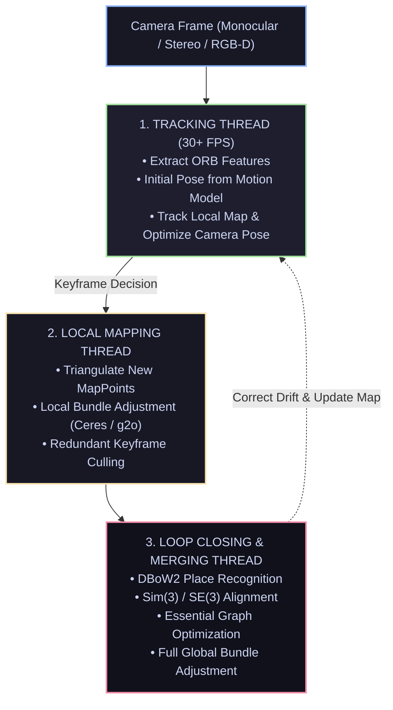

# 📄 ORB-SLAM & ORB-SLAM3: Accurate Visual & Visual-Inertial Multi-Map Systems

[ ⬅️ Back to Papers Index ](README.md) &nbsp;•&nbsp; [ 🏠 Hub Home ](../README.md)

---

## 📌 Metadata
* **Authors:** Raúl Mur-Artal, J. M. M. Montiel, Juan D. Tardós (ORB-SLAM, IEEE T-RO 2015); Carlos Campos et al. (ORB-SLAM3, IEEE T-RO 2021)
* **University:** University of Zaragoza, Spain
* **Paper Links:** [ORB-SLAM Paper](https://arxiv.org/abs/1502.00956) | [ORB-SLAM3 Paper](https://arxiv.org/abs/2007.11898)
* **Open-Source Repositories:** [raulmur/ORB_SLAM2](https://github.com/raulmur/ORB_SLAM2) | [UZ-SLAMLab/ORB_SLAM3](https://github.com/UZ-SLAMLab/ORB_SLAM3)
* **Core Contribution:** An open-source real-time feature-based visual SLAM architecture that introduced three parallel threads (Tracking, Local Mapping, Loop Closing) with multi-map capabilities and IMU inertial integration.

---

## 🔑 System Architecture: Three Parallel Threads

ORB-SLAM divides visual SLAM into three concurrent threads to guarantee real-time performance on commodity CPUs:

---

## 🔑 Core Algorithmic Breakthroughs

### 1. ORB (Oriented FAST and Rotated BRIEF) Features
* ORB provides scale and rotation invariance at a fraction of the computational cost of SIFT or SURF.
* Computed in **sub-15 milliseconds** per frame, allowing extraction of 1,000–2,000 features on CPU without GPU acceleration.
* Matching is executed using fast **Hamming distance** operations via CPU bitwise XOR instructions.

### 2. DBoW2 Bag-of-Visual-Words Place Recognition
* Visual words are indexed into a hierarchical vocabulary tree trained offline.
* Enables sub-10ms **Relocalization** when the camera is completely lost (e.g., covered by hands or sudden fast motions) and **Loop Detection** without spatial search bounds.

### 3. Local Bundle Adjustment (BA) & Essential Graph
* Instead of optimizing all historical camera poses on every frame (which would explode to $O(N^3)$), ORB-SLAM performs **Local Bundle Adjustment** only over a covisibility window of co-visible keyframes.
* When a loop is detected, the loop closing thread performs **Pose Graph Optimization** over the Essential Graph, distributing drift error globally in milliseconds.

### 4. ORB-SLAM3 Innovations (Visual-Inertial & Multi-Map)
* **Maximum-a-Posteriori (MAP) Inertial Initialization:** Solves for gyroscope and accelerometer biases, gravity direction, and metric scale within the first 2–4 seconds of motion.
* **Atlas Multi-Map System:** If visual tracking is lost for extended periods, the system does not fail or halt. It saves the previous map, spawns a new map, and automatically stitches both maps together seamlessly when a recognizable place is revisited!

---

## 🦾 Benchmark Performance
Across the standard **EuRoC MAV** and **TUM VI** benchmarks, ORB-SLAM3 achieves:
* **Position Error:** Less than **1.0%** of total trajectory length in complex indoor industrial environments.
* **Scale Drift:** 0% drift in stereo-inertial mode due to metric IMU accelerometer integration.
