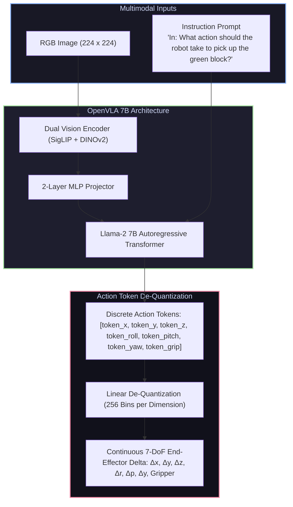

# 📄 OpenVLA: An Open-Source Vision-Language-Action Model

[ ⬅️ Back to Papers Index ](README.md) &nbsp;•&nbsp; [ 🏠 Hub Home ](../README.md)

---

## 📌 Metadata
* **Authors:** Moo Jin Kim, Karl Pertsch, Siddharth Karamcheti, Ted Xiao, Ashwin Balakrishna, Suraj Nair, Rafael Rafailov, Ethan Foster, Grace Lam, Pannag Sanketi, Quan Vuong, Thomas Kollar, Benjamin Burchfiel, Russ Tedrake, Dorsa Sadigh, Sergey Levine, Percy Liang, Chelsea Finn
* **Institutions:** Stanford University, UC Berkeley, Google DeepMind, Toyota Research Institute (TRI)
* **Venue:** arXiv preprint (arXiv:2406.09246, 2024)
* **Project Page:** [openvla.github.io](https://openvla.github.io/)
* **Official Code & Weights:** [openvla/openvla](https://github.com/openvla/openvla)
* **Core Contribution:** The first fully open-source, 7-billion-parameter generalist **Vision-Language-Action (VLA)** foundation model pretrained on 970k diverse robot episodes from the Open X-Embodiment dataset. Demonstrates state-of-the-art generalist manipulation and zero-shot parameter-efficient fine-tuning via LoRA.

---

## 🔑 Architecture & Action Tokenization

OpenVLA builds upon the **Prismatic VLM** framework, combining a **Llama-2 (7B)** language backbone with dual visual encoders (**SigLIP** for semantic visual reasoning + **DINOv2** for high-resolution spatial feature extraction):

### 1. Action Space Discretization
* The continuous 7-DoF action space is discretized into **256 uniform bins** per dimension between $[-1, 1]$.
* The 256 action bins are mapped directly to the least frequently used token IDs in the Llama-2 tokenizer vocabulary, allowing standard cross-entropy loss training without modifying the language vocabulary!

### 2. Pretraining on Open X-Embodiment (OXE)
* Pretrained on **970,000 real-world robot demonstrations** spanning 22 different robot embodiments, multiple camera angles, and hundreds of manipulation tasks.
* Learns robust cross-embodiment visual grounding, understanding concepts like "spoon", "sink", "wipe", and "pour" directly from physical demonstrations.

### 3. Rapid Adaptation via LoRA (Low-Rank Adaptation)
* Downstream users can adapt the 7B OpenVLA model to their own physical robot setup (e.g., WidowX arm or Franka Emika) by training **LoRA adapters** on just 50–100 local demonstrations in under **3 hours on a single consumer GPU (NVIDIA RTX 4090)**.

---

## 🦾 Real-World Findings
* **Zero-Shot Generalization:** Outperformed closed commercial models (such as RT-2-X 55B) by **16.5%** on out-of-distribution physical robot trials involving novel target objects, backgrounds, and spatial arrangements.
* **Inference Speed:** Can be quantized to 4-bit (bitsandbytes) to run locally at **8–10 Hz** on consumer workstation hardware.
