# 🔬 Landmark Robotics Research Papers & Architectural Reviews

[ 🏠 Hub Home ](../README.md) &nbsp;•&nbsp; [ 🗺️ Full Roadmap ](../robotics-roadmap.md) &nbsp;•&nbsp; [ 🛠️ Hardware Projects ➡️ ](../robotics_projects/resources.md)

---

## 📌 Overview & Scope
Robotics progresses through a continuous feedback loop between theoretical academia and physical hardware validation. Understanding foundational research papers—and knowing the exact mathematical breakthroughs that enable them—is mandatory for any serious robotics engineer or researcher.

This directory contains **in-depth architectural breakdowns**, mathematical formulations, algorithmic pseudocode, and practical engineering takeaways for landmark papers across **Path Planning**, **SLAM**, **Control**, and **Embodied AI / VLA Models**.

```mermaid
graph LR
    subgraph PLANNING["Search & Motion Planning"]
        A_STAR["A* Heuristic Search<br/>(Hart et al., 1968)"]
        RRT["RRT & RRT* Optimal Planning<br/>(LaValle / Karaman & Frazzoli)"]
    end

    subgraph SLAM["Spatial SLAM & Odometry"]
        FAST_SLAM["FastSLAM (Rao-Blackwellized)<br/>(Montemerlo & Thrun, 2002)"]
        ORB_SLAM["ORB-SLAM3 (Visual-Inertial Multi-Map)<br/>(Campos et al., 2021)"]
        FAST_LIO["Fast-LIO2 (ikd-Tree LiDAR-Inertial)<br/>(Xu et al., HKU 2022)"]
        SPLATAM["SplaTAM (3D Gaussian Splat SLAM)<br/>(Keetha et al., 2024)"]
    end

    subgraph EMBODIED["Embodied AI & Robot Learning"]
        DIFF["Diffusion Policy (Action Diffusion)<br/>(Chi et al., Columbia/Stanford 2023)"]
        OPENVLA["OpenVLA (7B Vision-Language-Action)<br/>(Kim et al., Stanford/Berkeley 2024)"]
    end

    PLANNING --> SLAM --> EMBODIED

    style PLANNING fill:#1e1e2e,stroke:#89b4fa,stroke-width:2px,color:#cdd6f4
    style SLAM fill:#181825,stroke:#a6e3a1,stroke-width:2px,color:#cdd6f4
    style EMBODIED fill:#11111b,stroke:#f38ba8,stroke-width:2px,color:#cdd6f4
```

---

## 📑 Paper Review Index

| Paper Review | Primary Venue | Core Innovation | Code & Breakdown |
| :--- | :--- | :--- | :--- |
| **[A* Path Planning](A_Star_Path_Planning.md)** | IEEE TSSC (1968) | Admissible heuristic graph search with guaranteed optimality | [Read Analysis ➔](A_Star_Path_Planning.md) |
| **[RRT & RRT* Motion Planning](RRT_Motion_Planning.md)** | IEEE ICRA / RSS | Sample-based motion planning with asymptotic optimality proof | [Read Analysis ➔](RRT_Motion_Planning.md) |
| **[FastSLAM](FastSLAM.md)** | AAAI (2002) | Rao-Blackwellized particle filter factoring SLAM into $M$ independent EKFs | [Read Analysis ➔](FastSLAM.md) |
| **[ORB-SLAM & ORB-SLAM3](ORB-SLAM.md)** | IEEE T-RO (2015/2021) | Multi-map visual-inertial SLAM with DBoW place recognition | [Read Analysis ➔](ORB-SLAM.md) |
| **[Fast-LIO2](Fast_LIO2.md)** | IEEE T-RO (2022) | Direct LiDAR-inertial odometry using dynamic incremental kd-tree (ikd-Tree) | [Read Analysis ➔](Fast_LIO2.md) |
| **[Diffusion Policy](Diffusion_Policy.md)** | RSS / IJRR (2023) | Visuomotor policy learning via conditional denoising diffusion processes | [Read Analysis ➔](Diffusion_Policy.md) |
| **[OpenVLA](OpenVLA.md)** | arXiv (2024) | 7B open-source generalist Vision-Language-Action model on Open X-Embodiment | [Read Analysis ➔](OpenVLA.md) |
| **[SplaTAM](SplaTAM.md)** | CVPR (2024) | Dense 3D Gaussian Splatting SLAM from monocular RGB-D video | [Read Analysis ➔](SplaTAM.md) |

---

## 🏛️ Key Conferences & Journals to Track
* **ICRA** (IEEE International Conference on Robotics and Automation) — The flagship annual robotics engineering conference.
* **IROS** (IEEE/RSJ International Conference on Intelligent Robots and Systems) — Premier systems, mechanics, and sensor conference.
* **RSS** (Robotics: Science and Systems) — Selective, mathematically rigorous theoretical and systems papers.
* **CoRL** (Conference on Robot Learning) — The leading venue for reinforcement learning, imitation learning, and foundation models in robotics.
* **IEEE T-RO** (IEEE Transactions on Robotics) — The highest-impact archival robotics journal.
* **IJRR** (International Journal of Robotics Research) — High-depth foundational research monographs.

---

[ ⬅️ Previous: Datasets ](../datasets/README.md) &nbsp;•&nbsp; [ Next: Hardware Projects ➡️ ](../robotics_projects/resources.md)

