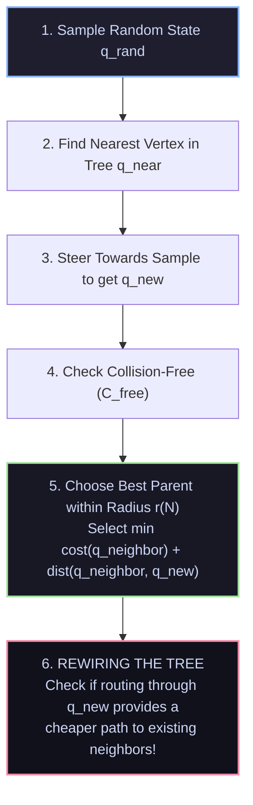

# 📄 Rapidly-Exploring Random Trees (RRT) & Optimal RRT*

[ ⬅️ Back to Papers Index ](README.md) &nbsp;•&nbsp; [ 🏠 Hub Home ](../README.md)

---

## 📌 Metadata
* **Authors:** Steven M. LaValle (RRT, 1998); Sertac Karaman and Emilio Frazzoli (RRT*, IEEE ICRA 2010 / RSS 2011)
* **Institutions:** Iowa State University / MIT
* **Paper Links:** [Original RRT Paper](https://msl.cs.uiuc.edu/~lavalle/papers/Lav98c.pdf) | [RRT* Optimality Paper](https://arxiv.org/abs/1105.1186)
* **Core Contribution:** Introduced sample-based motion planning designed for high-dimensional configuration spaces with differential constraints, followed by the rigorous proof of **Asymptotic Optimality** in RRT*.

---

## 🔑 Mathematical & Theoretical Concepts

Motion planning in continuous high-dimensional space $\mathcal{C}$ (e.g., a 7-DoF robotic arm or a 12-DoF humanoid) suffers from the **Curse of Dimensionality**; explicit grid-based search (like uniform A*) becomes computationally intractable.

### 1. Classical RRT (Rapidly-Exploring Random Tree)
* **Voronoi Bias:** RRT samples points uniformly from the configuration space $\mathcal{C}_{\text{free}}$. The probability that a tree vertex is selected for extension is proportional to the volume of its Voronoi cell. This inherently drives the search tree into unexplored areas.
* **Probabilistic Completeness:** If a valid trajectory exists, the probability that RRT finds a path approaches $1$ as sample iterations $N \to \infty$:
  $$\lim_{N \to \infty} P(\text{path found}) = 1$$
* **The Fatal Flaw of Classical RRT:** Classical RRT is **NOT asymptotically optimal**. With probability 1, the cost of the path returned does not converge to the optimal path $c^*$. It often produces jagged, suboptimal zig-zag routes.

### 2. RRT* (Asymptotically Optimal RRT)
Karaman and Frazzoli introduced two critical procedures that guarantee almost-sure convergence to the optimal solution ($\lim_{N \to \infty} c(N) = c^*$):

* **Near-Neighbor Search Radius:** Searches for neighbor vertices within a ball of shrinking radius:
  $$r(N) = \gamma \left( \frac{\log N}{N} \right)^{1/d}$$
  where $d$ is the dimension of the space and $\gamma$ is a constant.
* **The Rewiring Step:** For all vertices $q_{\text{near}}$ within radius $r(N)$, if:
  $$\text{cost}(q_{\text{new}}) + \text{dist}(q_{\text{new}}, q_{\text{near}}) < \text{cost}(q_{\text{near}})$$
  the tree edge to $q_{\text{near}}$ is severed and re-attached to $q_{\text{new}}$, continuously smoothing the graph.

---

## 🦾 Modern Implementations & Derivatives
* **Informed RRT*:** Restricts sampling to a prolate hyperspheroid (ellipse) bounded by current best path cost, accelerating convergence by $10\times$.
* **OMPL (Open Motion Planning Library):** The engine underlying **ROS 2 MoveIt 2**, containing production C++ implementations of RRT*, RRTConnect, and BIT* (Batch Informed Trees).
