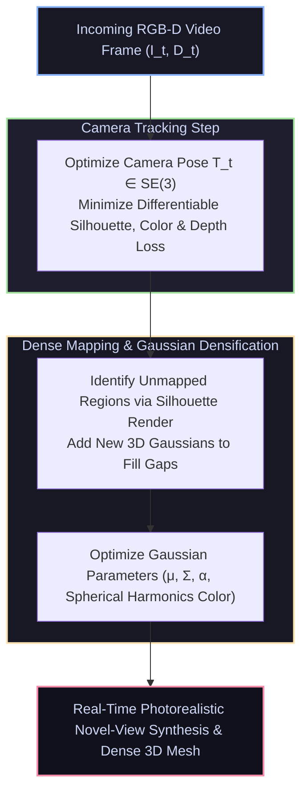

# 📄 SplaTAM: Splat, Track & Map with 3D Gaussians for Dense RGB-D SLAM

[ ⬅️ Back to Papers Index ](README.md) &nbsp;•&nbsp; [ 🏠 Hub Home ](../README.md)

---

## 📌 Metadata
* **Authors:** Nikhil Keetha, Jay Karhade, Krishna Murthy Jatavallabhula, Shuang Li, Ganesh Iyer, Chen Wang, Niraj K. Jha, Sebastian Scherer
* **Institutions:** Carnegie Mellon University (CMU), MIT, Princeton University
* **Venue:** IEEE/CVF Conference on Computer Vision and Pattern Recognition (CVPR 2024)
* **Project Page:** [spla-tam.github.io](https://spla-tam.github.io/)
* **Official Code:** [spla-tam/SplaTAM](https://github.com/spla-tam/SplaTAM)
* **Core Contribution:** The pioneering system to employ **3D Gaussian Splatting (3DGS)** as the sole underlying scene representation for dense visual SLAM. Solves camera tracking and dense mapping concurrently from continuous monocular RGB-D video streams, delivering real-time photorealistic scene reconstruction.

---

## 🔑 Motivation: Why 3D Gaussians Beat NeRFs and Voxels

| Representation | Rendering Speed | Volumetric Completeness | Memory Footprint | Gradient Flow for Tracking |
| :--- | :--- | :--- | :--- | :--- |
| **Sparse Points (ORB-SLAM)** | > 60 FPS | Extremely Sparse (Points only) | Low (~10 MB) | Geometric only, fails in textureless areas |
| **Occupancy Voxels (TSDF)** | ~30 FPS | Solid Surfaces, No Color Novelty | High ($O(V^3)$) | Iterative ICP on depth images |
| **Neural Fields (NeRF-SLAM)** | < 2 FPS | Dense, continuous | Medium (~50 MB) | Ray-marching gradient descent, very slow |
| **3D Gaussian Splatting (SplaTAM)** | **> 30–60 FPS** | **Dense, Photorealistic, Explicit** | **Medium (~30 MB)** | **Fast analytical rasterization gradients** |

---

## 🔑 Algorithmic Architecture

### 1. Camera Tracking via Analytical Splatting Gradients
Given the existing set of 3D Gaussians, the camera pose $T_t = [R_t, \mathbf{t}_t] \in SE(3)$ is optimized by directly minimizing the render loss against the incoming RGB and depth frame:
$$\mathcal{L}_{\text{track}} = \lambda_{\text{color}} \| I_t - \hat{I}_t \|_1 + \lambda_{\text{depth}} \| D_t - \hat{D}_t \|_1 + \lambda_{\text{sil}} (1 - \hat{S}_t)$$
Because 3D Gaussian tile-based rasterization is strictly analytical (no neural ray marching), backward gradients propagate to camera pose $T_t$ in milliseconds!

### 2. Silhouette-Guided Densification
How does the system know when the camera discovers a new room?
* SplaTAM renders a **binary silhouette mask** $\hat{S}_t$ of the current map.
* Where $\hat{S}_t(u, v) \approx 0$, no Gaussians currently explain that pixel. New 3D Gaussians are automatically unprojected from the measured depth $D_t(u, v)$ and added to the scene map.

---

## 🦾 Benchmark Results
* Tested on **ScanNet**, **TUM-RGBD**, and **Replica** datasets:
  * Achieved up to **2× lower camera trajectory drift (ATE)** compared to NeRF-based SLAM systems (e.g., NICE-SLAM).
  * Rendered photorealistic novel views with **PSNR > 34 dB** in real time.
