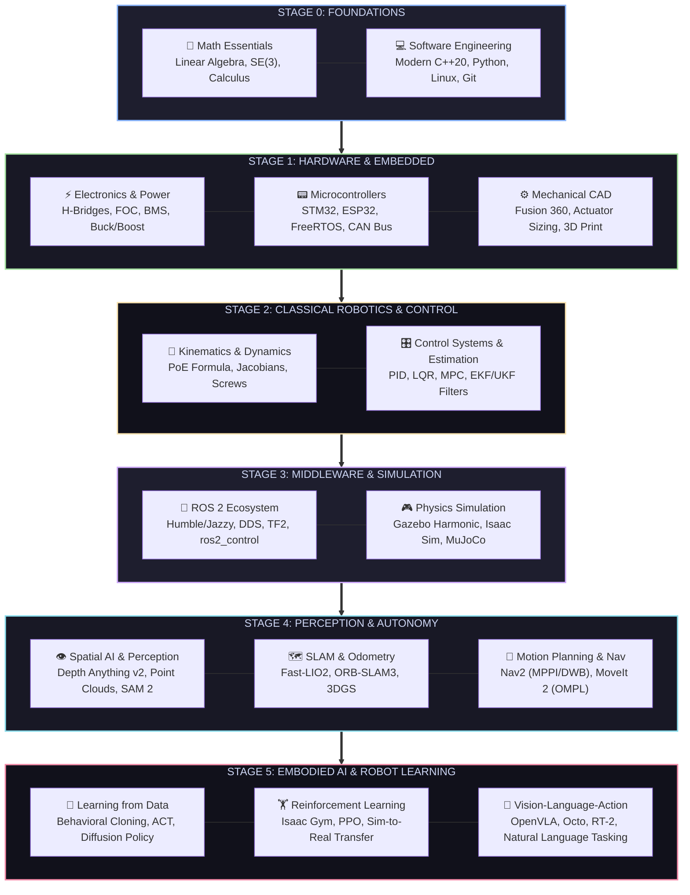

# 🗺️ Master Robotics Engineering Roadmap (2026 Edition)

> [!IMPORTANT]
> Robotics is an inherently cross-disciplinary craft. This roadmap provides a battle-tested, structured engineering progression from zero foundational knowledge to state-of-the-art Embodied AI and production robotics systems.

---

## 🧭 Visual Progression Flowchart

---

## 📌 Phase 0: Foundations (Math, Code & Linux)
*Estimated Duration: 6–8 Weeks*

Master the core tools that empower all modern robotics computation.

### 📐 Mathematics for Robotics
- [ ] **Linear Algebra:** Vector spaces, matrix transformations, eigenvalues/eigenvectors, SVD, Null space.
- [ ] **3D Rigid Body Transformations:** Rotation matrices ($SO(3)$), Euler angles, Unit Quaternions, Homogeneous Transformation Matrices ($SE(3)$).
- [ ] **Multivariable Calculus & Optimization:** Partial derivatives, gradients, Hessians, unconstrained optimization, Lagrange multipliers, Quadratic Programming (QP).
- [ ] **Probability & Statistics:** Gaussian distributions, multivariate Gaussians, covariance matrices, Bayes' Theorem.
- 🔗 **Detailed Resources:** [Mathematics Resource Guide](mathematics/README.md)

### 💻 Modern Programming & Environment
- [ ] **Linux Proficiency:** Ubuntu 22.04 / 24.04 LTS, Bash scripting, systemd, SSH, udev rules for serial peripherals.
- [ ] **Modern C++ (17/20):** RAII, smart pointers (`std::unique_ptr`, `std::shared_ptr`), move semantics, lambda functions, templates, STL containers, thread synchronization.
- [ ] **Python 3.12+:** NumPy array vectorization, SciPy, Matplotlib, object-oriented design, async execution.
- [ ] **Tooling & Build Systems:** Git version control, CMake, Colcon, GCC/Clang, Docker & Dev Containers.
- 🔗 **Detailed Resources:** [Programming & Linux Guide](programming/README.md)

> **🎯 Phase 0 Milestone:** Write a pure C++ and Python 3D math library calculating forward kinematics transformations given arbitrary joint angles and coordinate frames without external robotics libraries.

---

## 📌 Phase 1: Physical Realization (Electronics, Firmware & CAD)
*Estimated Duration: 6–8 Weeks*

Robots must exist in the real world. Learn how hardware components interact safely.

### ⚡ Electronics & Power Distribution
- [ ] **Circuit Fundamentals:** Ohm's Law, Kirchhoff's Laws, voltage dividers, RC filters, pull-up/pull-down resistors.
- [ ] **Power Management:** Battery chemistries (LiPo, LiFePO4), Battery Management Systems (BMS), DC-DC Buck/Boost switching regulators, ground loops and star grounding.
- [ ] **Actuator Drivers:** H-bridges (L298N, TB6612), MOSFET gate drivers, Field-Oriented Control (FOC) drivers (SimpleFOC, ODrive, VESC).
- [ ] **Sensors:** Quadrature optical & magnetic encoders (AMS AS5048), 6-DoF/9-DoF IMUs (MPU6050, ICM-20948), ToF distance sensors, ultrasonic transducers.
- [ ] **PCB Design:** KiCad 8 schematic capture, 2-layer PCB routing, ground planes, decoupling capacitors, TVS protection diodes.
- 🔗 **Detailed Resources:** [Electronics & Power Guide](electronics/README.md)

### 📟 Embedded Systems & Microcontrollers
- [ ] **Silicon Platforms:** ESP32-S3 (Dual-core, WiFi/BLE), STM32 Cortex-M4/M7, Teensy 4.1, Raspberry Pi RP2040.
- [ ] **Communication Protocols:** UART, SPI, I2C, CAN Bus (CAN 2.0B & CAN-FD).
- [ ] **Real-Time Programming:** Hardware timers, PWM generation, Interrupt Service Routines (ISRs), Direct Memory Access (DMA).
- [ ] **RTOS:** FreeRTOS (tasks, queues, semaphores, mutexes) or Zephyr RTOS.
- [ ] **micro-ROS:** Running ROS 2 communication directly on bare-metal microcontrollers over serial or UDP.
- 🔗 **Detailed Resources:** [Embedded Systems Guide](embedded_systems/README.md)

### ⚙️ Mechanical Design & Fabrication
- [ ] **CAD Modeling:** Autodesk Fusion 360 or Onshape parametric 3D modeling, assemblies, joints.
- [ ] **Actuators & Transmissions:** BLDC motors, stepper motors, servomotors, planetary gearboxes, harmonic/strain wave drives, cycloidal drives, GT2 timing belts, lead screws.
- [ ] **Digital Fabrication:** FDM 3D printing (PLA, PETG, Nylon-Carbon Fiber), slicing parameters, tolerancing, CNC machining basics, laser cutting.
- 🔗 **Detailed Resources:** [Mechanical Design Guide](mechanical_design/README.md)

> **🎯 Phase 1 Milestone:** Build a 2-wheeled self-balancing inverted pendulum robot running FreeRTOS with an IMU, magnetic encoders, and dual DC motor drivers.

---

## 📌 Phase 2: Classical Robotics Mechanics & Control Theory
*Estimated Duration: 8–10 Weeks*

Bridge physical mechanisms with rigorous control mathematics.

### 🦾 Kinematics & Dynamics
- [ ] **Forward Kinematics (FK):** Denavit-Hartenberg (D-H) parameters and the modern **Product of Exponentials (PoE)** formulation using Lie brackets and twists.
- [ ] **Inverse Kinematics (IK):** Analytical closed-form solutions (geometric, algebraic) and numerical methods (Newton-Raphson, Levenberg-Marquardt, Damped Least Squares).
- [ ] **Velocity Kinematics & Jacobians:** Geometric Jacobian, body/spatial Jacobians, kinematic singularities, manipulability index.
- [ ] **Dynamics:** Euler-Lagrange equations, Newton-Euler recursive algorithm, joint space inertia matrix, Coriolis and centrifugal terms, gravity compensation.
- 🔗 **Detailed Resources:** [Robotics Fundamentals Guide](robotics_fundamentals/README.md)

### 🎛️ Control Systems & State Estimation
- [ ] **Classical Control:** Feedback loops, PID tuning (Ziegler-Nichols, manual heuristic), anti-windup, derivative filtering, feedforward control.
- [ ] **Modern Control:** State-space representation ($\dot{x} = Ax + Bu$), Controllability and Observability Gramians, Pole placement, Linear Quadratic Regulator (LQR).
- [ ] **Optimal & Predictive Control:** Model Predictive Control (MPC), receding horizon, quadratic programs, CasADi and acados frameworks.
- [ ] **State Estimation:** Kalman Filter (KF), Extended Kalman Filter (EKF), Unscented Kalman Filter (UKF), Particle Filtering, sensor fusion (IMU + wheel odometry).
- 🔗 **Detailed Resources:** [Control Systems Guide](control_systems/README.md)

> **🎯 Phase 2 Milestone:** Implement a full state-feedback LQR controller and EKF state estimator in Python or C++ simulating an inverted double pendulum.

---

## 📌 Phase 3: The Robotic Nervous System (ROS 2 & Simulation)
*Estimated Duration: 6–8 Weeks*

Connect all distributed components into a scalable, industry-grade software architecture.

### 🤖 ROS 2 (Robot Operating System 2)
- [ ] **Core Concepts:** Nodes, Topics, Services, Actions, Parameters, Node Composition, Lifecycle Nodes.
- [ ] **DDS (Data Distribution Service):** Quality of Service (QoS) profiles: Reliability (Best-Effort vs Reliable), Durability (Transient Local vs Volatile), History depth.
- [ ] **Coordinate Transforms (TF2):** Tree structure, broadcast/listen frames (`base_link`, `odom`, `map`, `camera_link`), static transform publishers.
- [ ] **Robot Description:** Unified Robot Description Format (URDF), Xacro macro definitions, visual vs collision geometry, inertia tensors.
- [ ] **ros2_control:** Hardware interfaces, controller manager, JointStateBroadcaster, DiffDriveController, JointTrajectoryController.
- 🔗 **Detailed Resources:** [ROS 2 Deep-Dive Guide](ros/README.md)

### 🎮 Physics Simulation & Digital Twins
- [ ] **Modern Gazebo (Harmonic / Fortress):** Physics engines (DART), SDF formats, sensor plugins (LiDAR, RGB-D camera, IMU).
- [ ] **MuJoCo:** Fast rigid-body contact dynamics, MJCF XML models, Python bindings, tendon and muscle actuation.
- [ ] **NVIDIA Isaac Sim / Isaac Lab:** Omniverse platform, USD formats, PhysX GPU acceleration, photorealistic ray tracing, domain randomization.
- [ ] **Drake (MIT):** Mathematical optimization for trajectory generation and contact mechanics.
- 🔗 **Detailed Resources:** [Simulation Systems Guide](simulation/README.md)

> **🎯 Phase 3 Milestone:** Create a customized differential-drive robot model with Xacro, import it into Gazebo Harmonic, and interface it with `ros2_control` driven by keyboard teleoperation.

---

## 📌 Phase 4: Spatial AI, SLAM & Autonomous Navigation
*Estimated Duration: 8–10 Weeks*

Enable robots to perceive their surroundings, locate themselves, and chart intelligent paths.

### 👁️ Computer Vision & 3D Spatial Perception
- [ ] **Classic CV:** Camera pinhole model, intrinsic/extrinsic calibration, epipolar geometry, stereo disparity, feature detection (ORB, SIFT).
- [ ] **Deep Perception:** Object detection (YOLOv10, YOLOv11), zero-shot segmentation (SAM 2 - Segment Anything), foundation depth estimation (Depth Anything v2).
- [ ] **3D Data Structures:** Point Cloud Library (PCL), Open3D, voxel grids, kd-trees, surface normals, ICP (Iterative Closest Point) registration.
- [ ] **Novel View Synthesis & Neural Fields:** Neural Radiance Fields (NeRFs), 3D Gaussian Splatting (3DGS) for real-time dense scene representation.
- 🔗 **Detailed Resources:** [Computer Vision Guide](computer_vision/README.md)

### 🗺️ SLAM (Simultaneous Localization & Mapping)
- [ ] **2D LiDAR SLAM:** Occupancy grid mapping, scan matching, Gmapping, Cartographer, SlamToolbox.
- [ ] **3D LiDAR-Inertial Odometry:** Point-to-plane ICP, error-state Kalman filters, Fast-LIO2, LIO-SAM.
- [ ] **Visual SLAM:** Monocular, stereo, and RGB-D SLAM, bundle adjustment, loop closure detection, ORB-SLAM3, SplaTAM (Gaussian Splat SLAM).
- 🔗 **Detailed Resources:** [Landmark Research Papers](research_papers/README.md)

### 🧭 Autonomous Navigation & Motion Planning
- [ ] **Global Planning:** Dijkstra, A* algorithm, Hybrid A*, RRT* (Rapidly-exploring Random Trees), Informed RRT*, CHOMP, TrajOpt.
- [ ] **ROS 2 Nav2 Stack:** BT Navigator (Behavior Trees), Costmap2D (global & local layers), Recovery behaviors.
- [ ] **Local Trajectory Controllers:** Dynamic Window Approach (DWA), Regulated Pure Pursuit (RPP), Model Predictive Path Integral (MPPI) controller.
- [ ] **Arm Manipulation Planning:** MoveIt 2, OMPL (Open Motion Planning Library), Pilz industrial motion planner, collision checking with OctoMap.

> **🎯 Phase 4 Milestone:** Build and deploy a complete simulated mobile warehouse robot that maps an unknown environment using SlamToolbox, localizes, and autonomously navigates through dynamic obstacles using Nav2 with MPPI.

---

## 📌 Phase 5: Embodied AI & Modern Robot Learning
*Estimated Duration: 10–12 Weeks*

Empower robots to learn complex dexterous behaviors directly from sensory observation and trial.

### 🧠 Imitation Learning & Policy Representations
- [ ] **Behavioral Cloning (BC):** Direct supervised learning from demonstrations, compounding error / covariate shift problems.
- [ ] **Action Chunking with Transformers (ACT):** Predicting chunks of future actions from RGB-D observations and joint states.
- [ ] **Diffusion Policy:** Formulating robot action generation as a conditional denoising diffusion process (DDPM), multi-modal action distribution handling.
- [ ] **DP3 (3D Diffusion Policy):** Learning manipulation policies directly from 3D point cloud representations.
- [ ] **Open-Source Toolchains:** Hugging Face **LeRobot**, ALOHA teleoperation hardware, SO-ARM100 low-cost manipulators.
- 🔗 **Detailed Resources:** [AI & Machine Learning Guide](ai_ml/README.md)

### 🏋️ Reinforcement Learning & Sim-to-Real
- [ ] **Deep RL Fundamentals:** Markov Decision Processes (MDP), Policy Gradients, PPO (Proximal Policy Optimization), SAC (Soft Actor-Critic).
- [ ] **Massively Parallel Simulation:** NVIDIA Isaac Gym / Isaac Lab simulating 4096+ robot environments simultaneously on a single GPU.
- [ ] **Sim-to-Real Transfer:** Domain Randomization (friction, mass, sensor noise, motor latency), Privileged Learning / Teacher-Student distillation.
- [ ] **Legged Locomotion Policies:** Training quadrupeds and bipedal humanoids to walk, run, and traverse rugged terrain.

### 🌐 Vision-Language-Action (VLA) Foundation Models
- [ ] **VLA Architecture:** Pretrained multimodal LLMs (e.g., PaLI, Llama, Gemma) fine-tuned to emit discretized robot action tokens.
- [ ] **Landmark Models:** RT-1, RT-2, Octo, OpenVLA (7B open-source VLA), Physical Intelligence $\pi_0$.
- [ ] **LLMs for High-Level Planning:** Code as Policies, SayCan, Eureka (generating RL reward functions via LLMs).
- [ ] **Standardized Datasets:** Open X-Embodiment (OXE) dataset, DROID dataset, BridgeData v2.
- 🔗 **Detailed Resources:** [Datasets Guide](datasets/README.md)

> **🎯 Phase 5 Milestone:** Train a Diffusion Policy using LeRobot in simulation or on a physical desktop manipulator to execute a complex pick-and-place task conditioned on RGB camera inputs.

---

## 📈 Learning Progression Summary

| Phase | Core Competency | Target Project |
| :---: | :--- | :--- |
| **0** | C++20, Python, Linux, Linear Algebra & $SE(3)$ | Custom 3D Forward Kinematics Engine |
| **1** | Power, BMS, Gate Drivers, STM32/ESP32, CAD | Self-Balancing Inverted Pendulum Robot |
| **2** | PoE Kinematics, Dynamics, PID, LQR, MPC, EKF | Inverted Double Pendulum State-Feedback Controller |
| **3** | ROS 2 Humble/Jazzy, DDS, URDF, Gazebo, MuJoCo | Custom Gazebo Robot with `ros2_control` |
| **4** | Point Clouds, SLAM, Fast-LIO2, Nav2, MoveIt 2 | Autonomous Warehouse AMR Navigation with Nav2 |
| **5** | Diffusion Policy, ACT, Isaac Gym RL, VLA Models | Vision-Guided Manipulation with LeRobot / OpenVLA |

---

[ 🏠 Return to Hub Home ](README.md) &nbsp;•&nbsp; [ 🛠️ Browse Projects ](robotics_projects/resources.md) &nbsp;•&nbsp; [ 🔬 View Research Papers ](research_papers/resources.md)

