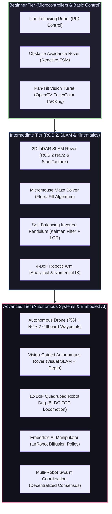

# 🛠️ Robotics Hardware & Simulation Projects Directory

[ 🏠 Hub Home ](../README.md) &nbsp;•&nbsp; [ 🗺️ Full Roadmap ](../robotics-roadmap.md) &nbsp;•&nbsp; [ 📑 Hardware Pinouts Cheat Sheet ](../cheatsheets/hardware-and-pinouts.md)

---

## 📌 Overview & Scope
Theory without hardware implementation is incomplete; hardware without rigorous theory is fragile. 

Every project in this directory is a complete, production-grade **engineering blueprint** featuring:
* **System Architecture Diagrams**
* **Full Bill of Materials (BOM)** with voltage ratings, interfaces, and estimated costs
* **Detailed Electrical Wiring Schematics**
* **Complete, Runnable Source Code** with clear comments
* **Calibration & Troubleshooting Walkthroughs**

---

## 📂 Project Navigation Index

### 🟢 Beginner Tier
| Project | Target Concepts | Hardware Stack | Blueprint Link |
| :--- | :--- | :--- | :--- |
| **Line Following Robot** | Proportional-Derivative (PD) control, ADC array sampling, H-Bridge | Arduino Uno / Nano, 5-IR Sensor Array, L298N/TB6612 | [Build Blueprint ➔](beginner/line_following_robot.md) |
| **Obstacle Avoidance Rover** | Finite State Machine (FSM), Ultrasonic / ToF echo timing, differential drive | ESP32 / Arduino, HC-SR04, Servo scan mount | [Build Blueprint ➔](beginner/obstacle_avoidance_robot.md) |
| **Pan-Tilt Vision Turret** | Computer Vision closed-loop visual servoing, PID tracking, serial bridge | USB Camera, 2x SG90/MG996R Servos, Python OpenCV | [Build Blueprint ➔](beginner/pan_tilt_vision_turret.md) |

### 🟡 Intermediate Tier
| Project | Target Concepts | Hardware Stack | Blueprint Link |
| :--- | :--- | :--- | :--- |
| **2D LiDAR SLAM Rover** | ROS 2 Humble/Jazzy, SlamToolbox, Nav2, URDF, Odometry EKF | Raspberry Pi 4/5, RPLiDAR A1/C1, Differential Chassis | [Build Blueprint ➔](intermediate/slam_robot.md) |
| **Micromouse Maze Solver** | Graph search, Manhattan distance flood-fill, quadrature encoder odometry | STM32 / Teensy, Custom PCB, ToF sensors, DC gearmotors | [Build Blueprint ➔](intermediate/maze_solving_robot.md) |
| **Self-Balancing Robot** | Inverted pendulum dynamics, complementary/Kalman filtering, LQR | ESP32, 6-DoF MPU6050, Stepper / Encodered DC Motors | [Build Blueprint ➔](intermediate/self_balancing_robot.md) |
| **4-DoF Robotic Arm with IK** | Forward & Inverse Kinematics (PoE), geometric IK, trajectory interpolation | 4x High-Torque Servos (MG996R / Bus Servos), Python/ESP32 | [Build Blueprint ➔](intermediate/robotic_arm_ik.md) |

### 🔴 Advanced Tier
| Project | Target Concepts | Hardware Stack | Blueprint Link |
| :--- | :--- | :--- | :--- |
| **Autonomous Drone** | PX4 Autopilot, MAVROS, MAVLink, Offboard position control, VIO | Pixhawk 6C, Raspberry Pi 4 Companion, Optical Flow / Camera | [Build Blueprint ➔](advanced/autonomous_drone.md) |
| **Vision-Based Navigation** | Monocular Depth Anything v2, Visual SLAM, Obstacle avoidance | NVIDIA Jetson Orin Nano, Intel RealSense D435i, ROS 2 | [Build Blueprint ➔](advanced/vision_based_navigation_robot.md) |
| **12-DoF Quadruped Robot Dog** | Quasi-Direct Drive (QDD), FOC, Bezier curve contact gait scheduling | 12x Brushless Actuators, Teensy 4.1 / Jetson, IMU | [Build Blueprint ➔](advanced/quadruped_robot.md) |
| **Embodied AI Manipulator** | Hugging Face LeRobot, ACT / Diffusion Policy, human teleoperation | SO-ARM100 / Koch Arm, Feetech Bus Servos, PyTorch | [Build Blueprint ➔](advanced/vla_manipulator.md) |
| **Multi-Robot Swarm** | Decentralized consensus, Laplacian matrix formation, ROS 2 Zenoh | 3x TurtleBot3 or Custom Differential Rovers, Wi-Fi | [Build Blueprint ➔](advanced/multi_robot_systems.md) |

---

[ ⬅️ Previous: Landmark Papers ](../research_papers/README.md) &nbsp;•&nbsp; [ 📑 Engineering Cheatsheets ➡️ ](../cheatsheets/README.md)

