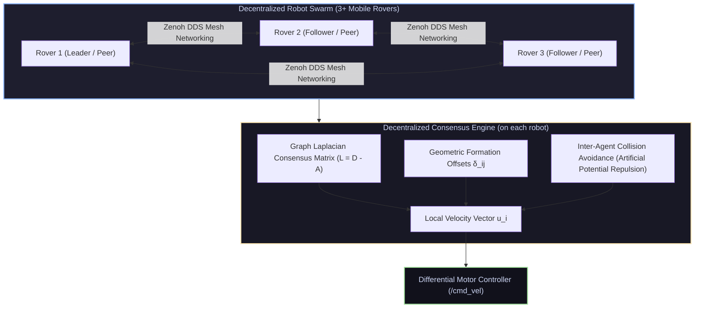

# 🐝 Multi-Robot Swarm Coordination & Formation Control

<div align="center">

[ ⬅️ Back to Projects Directory ](../README.md) &nbsp;•&nbsp; [ 🏠 Hub Home ](../../README.md)

</div>

---

## 📌 Project Overview
Swarm robotics distributes perception, mapping, and payload transport across fleets of autonomous robots without a single centralized point of failure. This blueprint covers the mathematical formulation and ROS 2 implementation of a **decentralized multi-robot formation control** system where individual rovers maintain geometric formations (e.g., triangle, line, circle) while navigating through obstacle fields using **Graph Laplacian Consensus** and **Artificial Potential Fields**.



---

## 📋 Bill of Materials (BOM)

| Component | Specification | Quantity | Interface / Voltage | Est. Cost (USD) |
| :--- | :--- | :---: | :--- | :---: |
| **Mobile Robots** | 3x TurtleBot3 Burger or Custom 2WD Rovers | 3 | Complete mobile chassis | \$450.00 – \$1,200 |
| **SBCs** | Raspberry Pi 4 (2GB/4GB) per robot | 3 | Running ROS 2 Humble/Jazzy | \$135.00 |
| **Mesh Router** | 5 GHz Wi-Fi 6 Router (Low latency, multicast enabled) | 1 | High-throughput local mesh | \$45.00 |
| **Sensors** | 3x 2D LiDAR (for inter-agent and obstacle detection) | 3 | USB Serial | \$180.00 |

---

## 🔑 Mathematical Foundation: Graph Laplacian Consensus

Let a swarm of $N$ robots be modeled as an undirected communication graph $\mathcal{G} = (\mathcal{V}, \mathcal{E})$:
* $\mathcal{V} = \{1, 2, \dots, N\}$: The set of robot nodes.
* $\mathcal{E}$: The set of active communication links between neighbor robots.
* **Adjacency Matrix ($A$):** $a_{ij} = 1$ if robots $i$ and $j$ are within communication radius, else $0$.
* **Degree Matrix ($D$):** Diagonal matrix where $d_{ii} = \sum_j a_{ij}$ (number of connected neighbors).
* **Graph Laplacian Matrix ($L$):**
  $$L = D - A$$

### Formation Consensus Control Law
To maintain a desired relative geometric offset $\boldsymbol{\delta}_{ij} = \mathbf{p}_i^* - \mathbf{p}_j^*$ while tracking a group trajectory:
$$\dot{\mathbf{p}}_i = -\sum_{j \in \mathcal{N}_i} a_{ij} \left( (\mathbf{p}_i - \mathbf{p}_j) - \boldsymbol{\delta}_{ij} \right) + \mathbf{f}_{\text{repulsive}} + \mathbf{v}_{\text{nav}}$$

* If the communication graph $\mathcal{G}$ is connected, the second eigenvalue of the Laplacian $\lambda_2(L) > 0$ (the **Algebraic Connectivity** or **Fiedler value**), guaranteeing exponential convergence of the swarm to the desired geometric formation!
* **Collision Avoidance:** A repulsive potential field activates whenever inter-agent distance $d_{ij} < d_{\text{safety}}$:
  $$\mathbf{f}_{\text{repulsive}} = \sum_{j \in \mathcal{N}_i, d_{ij} < d_{\text{safe}}} k_{\text{rep}} \left( \frac{1}{d_{ij}} - \frac{1}{d_{\text{safe}}} \right) \frac{\mathbf{p}_i - \mathbf{p}_j}{d_{ij}^3}$$

---

## 💻 Python Swarm Consensus Simulator & Controller

```python
import numpy as np
import matplotlib.pyplot as plt

# 4 Robots forming a Diamond formation
N = 4
dt = 0.05

# Desired relative offsets relative to group centroid
delta = np.array([
    [0.0,  1.5],   # Robot 0: Front
    [-1.5, 0.0],   # Robot 1: Left
    [1.5,  0.0],   # Robot 2: Right
    [0.0, -1.5]    # Robot 3: Rear
])

# Random initial positions
np.random.seed(42)
positions = np.random.uniform(-4.0, 4.0, size=(N, 2))

# Fully-connected communication graph
A = np.ones((N, N)) - np.eye(N)
D = np.diag(np.sum(A, axis=1))
L = D - A # Graph Laplacian

# Target group navigation velocity
v_group = np.array([0.5, 0.2])

for step in range(200):
    velocities = np.zeros_like(positions)

    for i in range(N):
        # Consensus formation term
        consensus_term = np.zeros(2)
        repulsion_term = np.zeros(2)

        for j in range(N):
            if i != j:
                p_ij = positions[i] - positions[j]
                desired_offset = delta[i] - delta[j]
                consensus_term += -(p_ij - desired_offset)

                # Inter-robot collision avoidance
                dist = np.linalg.norm(p_ij)
                if dist < 0.8:
                    repulsion_term += 2.0 * (1.0/dist - 1.0/0.8) * (p_ij / dist**3)

        velocities[i] = 1.2 * consensus_term + repulsion_term + v_group

    # Step forward
    positions += velocities * dt

print("Formation Convergence Achieved!")
print("Final Relative Offsets from Centroid:")
centroid = np.mean(positions, axis=0)
for i in range(N):
    print(f"  Robot {i}: Offset = {(positions[i] - centroid).round(2)} (Target: {delta[i]})")
```

---

## ⚡ ROS 2 Wireless Networking: Eclipse Zenoh
* Standard ROS 2 multicast DDS discovery struggles over congested multi-robot Wi-Fi networks (packet loss causes nodes to drop out).
* Modern multi-robot fleets deploy **Eclipse Zenoh** (`rmw_zenoh_cpp`), which provides sub-millisecond unicast peering, zero-discovery multicasting, and up to **90% lower bandwidth overhead** than traditional DDS.
