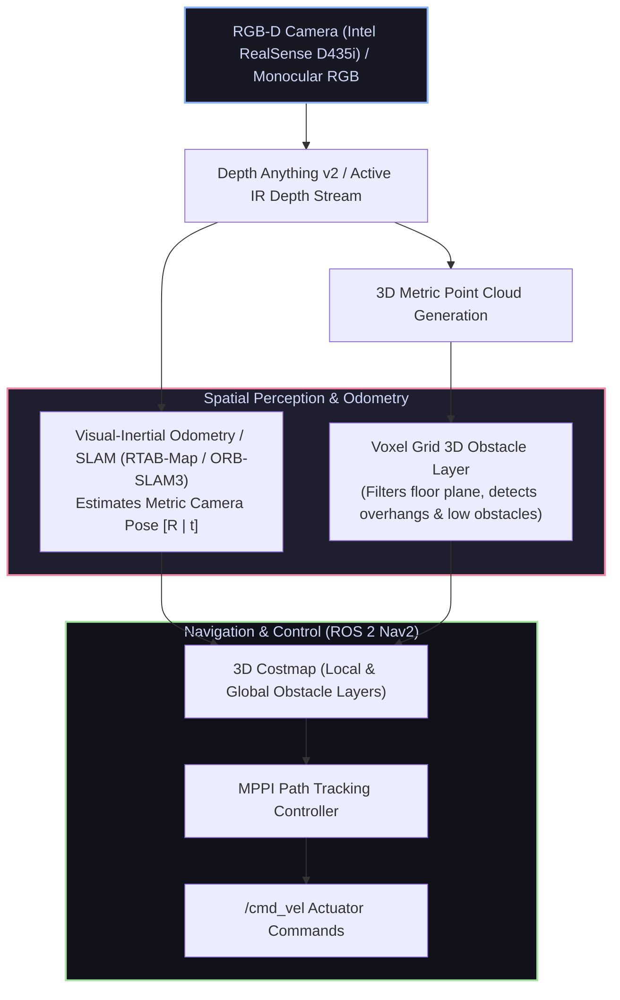

# 👁️ Vision-Guided Autonomous Rover with Spatial AI & Depth Anything

<div align="center">

[ ⬅️ Back to Projects Directory ](../README.md) &nbsp;•&nbsp; [ 🏠 Hub Home ](../../README.md)

</div>

---

## 📌 Project Overview
An advanced perception and navigation blueprint for an autonomous mobile robot that operates **without traditional spinning LiDAR**. 

Instead, the rover relies exclusively on visual spatial intelligence: combining an RGB-D camera (or monocular RGB camera processed via **Depth Anything v2**) with **Visual SLAM (ORB-SLAM3 / RTAB-Map)** to perform real-time 3D spatial mapping, point cloud obstacle avoidance, and goal navigation.



---

## 📋 Bill of Materials (BOM)

| Component | Specification | Quantity | Interface / Voltage | Est. Cost (USD) |
| :--- | :--- | :---: | :--- | :---: |
| **Edge AI Computer** | NVIDIA Jetson Orin Nano (8GB) | 1 | 40 TOPS AI, Ubuntu 22.04 LTS (9V–19V DC) | \$250.00 |
| **Depth Camera** | Intel RealSense D435i or Oak-D Pro | 1 | USB 3.1 Type-C / Stereo IR + RGB | \$250.00 |
| **Chassis & Motors**| 4WD Mecanum Wheel or Differential Base | 1 | High-clearance all-terrain rover | \$85.00 |
| **Motor Drivers** | Dual VESC or MDD10A 10A Motor Controllers | 1 | CAN Bus / UART | \$55.00 |
| **Power Source** | 4S LiFePO4 or 4S LiPo Battery (14.8V, 5000mAh) | 1 | XT60 | \$45.00 |
| **Step-Down Buck** | 12V 5A High-Current Regulator | 1 | Powers Jetson Orin | \$12.00 |

---

## 🔑 Processing RGB-D Data for Navigation 2 (Nav2)

Standard Nav2 planners operate on costmaps. There are two primary techniques to feed 3D vision into Nav2:

### Approach A: Synthetic 2D Laser Scan (`depthimage_to_laserscan`)
* Slices a horizontal cross-section of the depth image (e.g., from height $z = 10\text{cm}$ to $z = 40\text{cm}$) and publishes a standard `sensor_msgs/msg/LaserScan` topic.
* Extremely lightweight on CPU/GPU, but blind to low-lying obstacles below the slice plane or hanging tables above it.

### Approach B: Full 3D Voxel Costmap (`nav2_costmap_2d::VoxelLayer`)
* Ingests full 3D point clouds (`sensor_msgs/msg/PointCloud2`).
* Discretizes 3D space into a voxel grid.
* Automatically marks ground plane points (using normal vector thresholds) as free space, while marking obstacles higher than ground clearance as impassable cells.

---

## 💻 ROS 2 Visual Navigation Launch Script (Python)

```python
from launch import LaunchDescription
from launch_ros.actions import Node
from launch.actions import IncludeLaunchDescription
from launch.launch_description_sources import PythonLaunchDescriptionSource
import os
from ament_index_python.packages import get_package_share_directory

def generate_launch_description():
    realsense_pkg = get_package_share_directory('realsense2_camera')
    rtabmap_pkg = get_package_share_directory('rtabmap_ros')

    # 1. RealSense D435i Node: Publish aligned RGB + Depth + IMU
    realsense_node = IncludeLaunchDescription(
        PythonLaunchDescriptionSource(os.path.join(realsense_pkg, 'launch', 'rs_launch.py')),
        launch_arguments={
            'enable_color': 'true',
            'enable_depth': 'true',
            'align_depth': 'true',
            'enable_gyro': 'true',
            'enable_accel': 'true',
            'unite_imu_method': '2', # Unite linear accel + angular velocity
            'rgb_camera.profile': '640x480x30',
            'depth_module.profile': '640x480x30',
        }.items()
    )

    # 2. RTAB-Map Visual SLAM Node
    rtabmap_node = Node(
        package='rtabmap_ros',
        executable='rtabmap',
        output='screen',
        parameters=[{
            'frame_id': 'base_link',
            'subscribe_depth': True,
            'subscribe_rgb': True,
            'subscribe_scan': False,
            'approx_sync': True,
            'RGBD/LinearUpdate': '0.05', # Minimum motion to insert keyframe
            'RGBD/AngularUpdate': '0.05',
            'Reg/Strategy': '0',         # 0=Visual, 1=ICP, 2=Visual+ICP
            'Grid/FromDepth': 'true',    # Generate 2D occupancy grid from 3D depth
            'Grid/MaxObstacleHeight': '1.5',
            'Grid/MinGroundHeight': '0.05'
        }],
        remappings=[
            ('rgb/image', '/camera/camera/color/image_raw'),
            ('depth/image', '/camera/camera/aligned_depth_to_color/image_raw'),
            ('rgb/camera_info', '/camera/camera/color/camera_info'),
            ('grid_map', '/map')
        ]
    )

    return LaunchDescription([
        realsense_node,
        rtabmap_node
    ])
```

---

## 🔧 Overcoming Common Vision SLAM Failure Modes
* **Featureless Environments (Blank White Hallways):** Standard visual feature tracking fails on plain walls. Active IR stereo cameras (like RealSense D435i) project an invisible pseudo-random infrared dot pattern onto walls, providing artificial texture for reliable depth extraction!
* **Motion Blur During Rapid Turns:** Clamp your robot's maximum angular velocity in `nav2_params.yaml` to $\le 1.0\text{ rad/s}$ to ensure sharp camera exposure.
