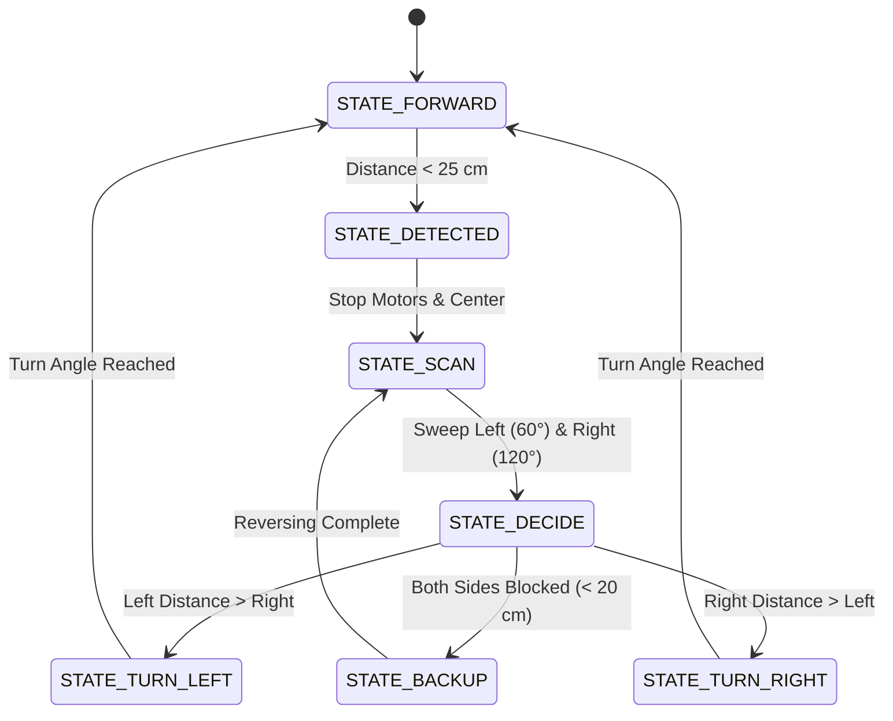

# 🤖 Autonomous Obstacle Avoidance Rover with Scanning Sonar

<div align="center">

[ ⬅️ Back to Projects Directory ](../README.md) &nbsp;•&nbsp; [ 🏠 Hub Home ](../../README.md)

</div>

---

## 📌 Project Overview
An autonomous wheeled rover that navigates unstructured indoor environments without human intervention. The rover employs an ultrasonic rangefinder mounted on an active panning servomotor to create a dynamic angular distance profile, driven by a non-blocking **Finite State Machine (FSM)**.



---

## 📋 Bill of Materials (BOM)

| Component | Specification | Quantity | Voltage / Interface | Est. Cost (USD) |
| :--- | :--- | :---: | :--- | :---: |
| **Microcontroller** | ESP32 NodeMCU or Arduino Uno | 1 | 5V / 3.3V GPIO | \$4.50 |
| **Ultrasonic Sensor**| HC-SR04 or RCWL-1601 (3.3V/5V) | 1 | Trigger & Echo Pins | \$2.00 |
| **Pan Servo** | TowerPro SG90 9g Micro Servo | 1 | 5V PWM (50 Hz) | \$2.50 |
| **Motor Driver** | L298N Dual H-Bridge Module | 1 | 7–12V DC | \$3.00 |
| **Actuators** | 2x TT Yellow DC Gearmotors (1:48) | 2 | 3–6V DC | \$4.00 |
| **Chassis Kit** | 2WD Acrylic Base with Omni Caster | 1 | Mechanical frame + wheels | \$7.00 |
| **Power Source** | 2x 18650 Li-ion Cells in Series (7.4V) | 2 | 7.4V Nominal | \$6.00 |
| **Switch & Mount** | Rocker Switch + Ultrasonic Bracket | 1 | Power toggle & pan mount | \$2.00 |

---

## ⚡ Electrical Wiring Pinout

```
Microcontroller Pin   Connected Module & Pin
─────────────────────────────────────────────────────────────
Pin D2                HC-SR04 TRIG (Trigger Pulse)
Pin D3                HC-SR04 ECHO (Echo Pulse via divider if 3.3V)
Pin D9 (PWM)          SG90 Servo Signal (Orange wire)
Pin D5 (PWM)          L298N ENA (Left Motor Speed)
Pin D6 (PWM)          L298N ENB (Right Motor Speed)
Pin D7                L298N IN1 (Left Motor Forward)
Pin D8                L298N IN2 (Left Motor Reverse)
Pin D10               L298N IN3 (Right Motor Forward)
Pin D11               L298N IN4 (Right Motor Reverse)
5V Output (L298N)     MCU 5V / VIN, Servo VCC, HC-SR04 VCC
Common GND            Shared Battery Ground, MCU, L298N, Servo
```

---

## 💻 Complete Arduino / ESP32 Firmware (C++)

```cpp
#include <Servo.h>

// Sensor & Actuator Pins
const int PIN_TRIG = 2;
const int PIN_ECHO = 3;
const int PIN_SERVO = 9;

// Motor Pins
const int PIN_ENA = 5;
const int PIN_ENB = 6;
const int PIN_IN1 = 7;
const int PIN_IN2 = 8;
const int PIN_IN3 = 10;
const int PIN_IN4 = 11;

Servo head_servo;

enum RoverState {
    FORWARD,
    SCANNING,
    TURN_LEFT,
    TURN_RIGHT,
    BACKUP
};

RoverState current_state = FORWARD;
const int CRITICAL_DISTANCE_CM = 25;

long measure_distance_cm() {
    digitalWrite(PIN_TRIG, LOW);
    delayMicroseconds(2);
    digitalWrite(PIN_TRIG, HIGH);
    delayMicroseconds(10);
    digitalWrite(PIN_TRIG, LOW);

    long duration = pulseIn(PIN_ECHO, HIGH, 30000); // 30ms timeout (~5 meters)
    if (duration == 0) return 999; // No echo, clear open space
    return duration * 0.0343 / 2;
}

void drive(int left_speed, int right_speed) {
    digitalWrite(PIN_IN1, left_speed >= 0 ? HIGH : LOW);
    digitalWrite(PIN_IN2, left_speed >= 0 ? LOW : HIGH);
    digitalWrite(PIN_IN3, right_speed >= 0 ? HIGH : LOW);
    digitalWrite(PIN_IN4, right_speed >= 0 ? LOW : HIGH);

    analogWrite(PIN_ENA, constrain(abs(left_speed), 0, 255));
    analogWrite(PIN_ENB, constrain(abs(right_speed), 0, 255));
}

void setup() {
    pinMode(PIN_TRIG, OUTPUT);
    pinMode(PIN_ECHO, INPUT);
    pinMode(PIN_ENA, OUTPUT);
    pinMode(PIN_ENB, OUTPUT);
    pinMode(PIN_IN1, OUTPUT);
    pinMode(PIN_IN2, OUTPUT);
    pinMode(PIN_IN3, OUTPUT);
    pinMode(PIN_IN4, OUTPUT);

    head_servo.attach(PIN_SERVO);
    head_servo.write(90); // Look straight ahead
    delay(500);
}

void loop() {
    switch (current_state) {
        case FORWARD: {
            long dist = measure_distance_cm();
            if (dist < CRITICAL_DISTANCE_CM) {
                drive(0, 0); // Emergency stop
                current_state = SCANNING;
            } else {
                drive(180, 180); // Cruise forward
                delay(30);
            }
            break;
        }

        case SCANNING: {
            drive(0, 0);

            // Look Left (150 degrees)
            head_servo.write(150);
            delay(350);
            long dist_left = measure_distance_cm();

            // Look Right (30 degrees)
            head_servo.write(30);
            delay(450);
            long dist_right = measure_distance_cm();

            // Return center
            head_servo.write(90);
            delay(250);

            if (dist_left < 20 && dist_right < 20) {
                current_state = BACKUP;
            } else if (dist_left >= dist_right) {
                current_state = TURN_LEFT;
            } else {
                current_state = TURN_RIGHT;
            }
            break;
        }

        case TURN_LEFT:
            drive(-190, 190); // Pivot turn left
            delay(320);
            drive(0, 0);
            current_state = FORWARD;
            break;

        case TURN_RIGHT:
            drive(190, -190); // Pivot turn right
            delay(320);
            drive(0, 0);
            current_state = FORWARD;
            break;

        case BACKUP:
            drive(-170, -170); // Reverse away from corner
            delay(500);
            drive(190, -190);  // 180-degree turn
            delay(450);
            current_state = FORWARD;
            break;
    }
}
```

---

## 🔧 Calibration & Assembly Tips
1. **Echo Pin Voltage Dividers:** If using an ESP32 (3.3V logic) with a 5V HC-SR04, place a voltage divider ($1\text{k}\Omega$ and $2\text{k}\Omega$ resistors) on the `ECHO` output pin to step the 5V pulse down to 3.3V to protect the MCU.
2. **Servo Noise:** Actuating the servo can cause sudden current draws. Place a $100\mu\text{F}$ electrolytic capacitor across the servo power lines ($+5V$ and $GND$) to eliminate MCU resets.
3. **Turn Calibration:** Adjust the `delay(320)` in `TURN_LEFT` and `TURN_RIGHT` to match your floor friction until the rover rotates approximately 60° to 90°.
