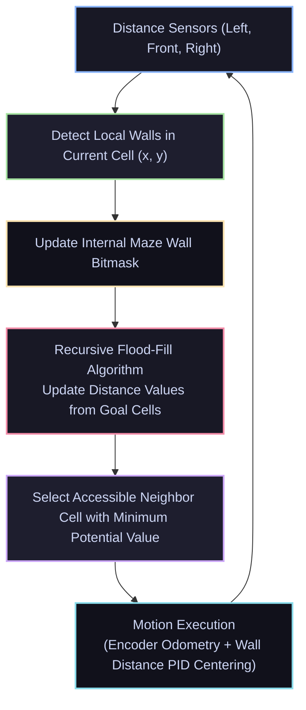

# 🐭 Autonomous Micromouse Maze Solver with Flood-Fill

<div align="center">

[ ⬅️ Back to Projects Directory ](../README.md) &nbsp;•&nbsp; [ 🏠 Hub Home ](../../README.md)

</div>

---

## 📌 Project Overview
The **Micromouse** challenge is one of the most prestigious mechatronics competitions in the world. An autonomous miniature robot is placed in an unknown $16 \times 16$ maze (standard 18cm $\times$ 18cm cell grid). The robot must explore the maze, dynamically discover walls using infrared/ToF distance sensors, calculate the shortest route to the central destination using the **Flood-Fill Algorithm**, and then execute a high-speed speed-run.



---

## 📋 Bill of Materials (BOM)

| Component | Specification | Quantity | Interface / Voltage | Est. Cost (USD) |
| :--- | :--- | :---: | :--- | :---: |
| **Microcontroller** | STM32F401 / STM32F411 "BlackPill" or Teensy 4.0 | 1 | 3.3V Logic / 100MHz+ | \$5.00 |
| **Sensors** | 3x VL53L0X or VL53L1X Time-of-Flight (ToF) | 3 | I2C (Short distance 2m) | \$9.00 |
| **Motors** | Micro Coreless DC Motors or Pololu Micro Metal Gearmotors | 2 | 6V 30:1 HP with Magnetic Encoders | \$28.00 |
| **Motor Driver** | DRV8833 or TB6612FNG Dual H-Bridge | 1 | 3.3V Logic / Low RDS(on) | \$3.00 |
| **Wheels** | Custom 3D Printed Hubs + Mini-Z Foam / Rubber Tires | 2 | Ultra-high grip | \$4.00 |
| **Power Source** | 1S/2S LiPo (3.7V - 7.4V, 300mAh, 45C) | 1 | High-current discharge | \$8.00 |
| **Chassis** | 4-Layer Integrated PCB Frame (All-in-one) | 1 | Lightweight (< 100 grams) | \$15.00 |

---

## 🔑 The Flood-Fill Maze Solving Algorithm

1. **Initialization:** Every cell $(x, y)$ in the $16 \times 16$ grid is initialized with its Manhattan distance to the center 4 destination cells:
   $$\text{dist}(x, y) = \min(|x - x_{\text{goal}}|, |y - y_{\text{goal}}|)$$
   The 4 center goal cells $((7,7), (7,8), (8,7), (8,8))$ have distance $0$.
2. **Wall Update:** As the mouse moves into cell $(x, y)$, its onboard sensors detect walls (North, East, South, West). The global wall map is updated.
3. **Flood Check:** If the current cell's value is not strictly equal to $1 + \min(\text{accessible neighbors})$, the cell is placed into a FIFO queue to trigger a recursive flood-fill wave:
   * Pop cell from queue.
   * Update its value to $1 + \min(\text{accessible neighbors})$.
   * Push all open neighbor cells to the queue to propagate the new barrier cost.
4. **Action:** The mouse steps into the accessible neighbor cell that possesses the lowest numerical potential value.

---

## 💻 C++ Flood-Fill Implementation (Embeddable Core)

```cpp
#include <iostream>
#include <queue>
#include <algorithm>

const int MAZE_SIZE = 16;

// Wall bitmasks: North=1, East=2, South=4, West=8
uint8_t walls[MAZE_SIZE][MAZE_SIZE];
uint16_t dist[MAZE_SIZE][MAZE_SIZE];

struct Cell {
    int x, y;
};

void initialize_maze() {
    for (int x = 0; x < MAZE_SIZE; x++) {
        for (int y = 0; y < MAZE_SIZE; y++) {
            walls[x][y] = 0;
            // Calculate initial Manhattan distance to 4 center cells (7,7), (7,8), (8,7), (8,8)
            int dx = std::min(abs(x - 7), abs(x - 8));
            int dy = std::min(abs(y - 7), abs(y - 8));
            dist[x][y] = dx + dy;
        }
    }
    // Set perimeter outer boundary walls
    for (int i = 0; i < MAZE_SIZE; i++) {
        walls[i][0] |= 4;              // South wall
        walls[i][MAZE_SIZE - 1] |= 1;  // North wall
        walls[0][i] |= 8;              // West wall
        walls[MAZE_SIZE - 1][i] |= 2;  // East wall
    }
}

bool has_wall(int x, int y, int direction) {
    // 0: North, 1: East, 2: South, 3: West
    return (walls[x][y] & (1 << direction)) != 0;
}

void flood_fill(int start_x, int start_y) {
    std::queue<Cell> q;
    q.push({start_x, start_y});

    const int dx[4] = {0, 1, 0, -1};
    const int dy[4] = {1, 0, -1, 0};

    while (!q.empty()) {
        Cell c = q.front();
        q.pop();

        // Goal cells are fixed at 0
        if ((c.x == 7 || c.x == 8) && (c.y == 7 || c.y == 8)) continue;

        uint16_t min_neighbor = 65535;
        for (int d = 0; d < 4; d++) {
            if (!has_wall(c.x, c.y, d)) {
                int nx = c.x + dx[d];
                int ny = c.y + dy[d];
                if (nx >= 0 && nx < MAZE_SIZE && ny >= 0 && ny < MAZE_SIZE) {
                    min_neighbor = std::min(min_neighbor, dist[nx][ny]);
                }
            }
        }

        if (dist[c.x][c.y] != min_neighbor + 1) {
            dist[c.x][c.y] = min_neighbor + 1;
            // Push open neighbors to propagate cost updates
            for (int d = 0; d < 4; d++) {
                if (!has_wall(c.x, c.y, d)) {
                    int nx = c.x + dx[d];
                    int ny = c.y + dy[d];
                    if (nx >= 0 && nx < MAZE_SIZE && ny >= 0 && ny < MAZE_SIZE) {
                        q.push({nx, ny});
                    }
                }
            }
        }
    }
}
```

---

## 🔧 High-Speed Tuning Secrets
* **Diagonal Moves (Smooth-Turns):** Once the robot discovers the optimal path during search runs, it can replace discrete 90-degree stop-and-turns with smooth circular arc turns or 45-degree diagonal lines across empty cell corners to reach speeds exceeding **3 meters/second**!
* **Wall Distance Centering PID:** When driving through corridors with walls on both left and right, use a differential PID loop:
  $$e(t) = \text{dist}_{\text{left}} - \text{dist}_{\text{right}}$$
  to ensure the mouse remains centered precisely on the corridor midline.
