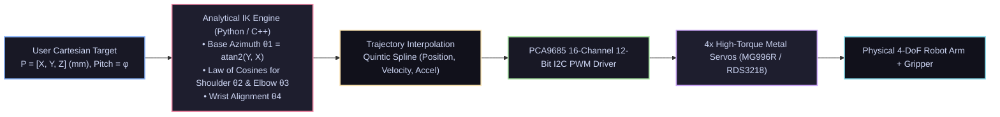

# 🦾 4-DoF Robotic Arm with Analytical Inverse Kinematics (IK)

<div align="center">

[ ⬅️ Back to Projects Directory ](../README.md) &nbsp;•&nbsp; [ 🏠 Hub Home ](../../README.md)

</div>

---

## 📌 Project Overview
A 4-Degree-of-Freedom (4-DoF) articulated desktop robotic arm capable of precision Cartesian pick-and-place manipulation. Instead of commanding arbitrary joint angles manually, the operator commands target coordinates $(X, Y, Z)$ in millimeters and an end-effector approach angle $\phi$. An analytical **Geometric Inverse Kinematics** engine solves for the exact 4 joint angles in microseconds and generates smooth quintic polynomial trajectory splines.



---

## 📋 Bill of Materials (BOM)

| Component | Specification | Quantity | Interface / Voltage | Est. Cost (USD) |
| :--- | :--- | :---: | :--- | :---: |
| **Arm Mechanical Kit** | 4-DoF / 5-DoF Black Aluminum Bracket Kit + Gripper | 1 | Stamped aluminum brackets | \$22.00 |
| **Actuators (Base/Shoulder/Elbow)**| RDS3218 (20 kg·cm Digital) or MG996R Metal Servos | 3 | 5V–7.4V PWM (High Torque) | \$24.00 |
| **Actuators (Wrist & Claw)** | MG90S Micro Metal Gear Servos | 2 | 5V PWM | \$6.00 |
| **Servo Driver Board** | PCA9685 16-Channel 12-Bit PWM Driver | 1 | I2C (Address 0x40) | \$4.00 |
| **Controller** | Raspberry Pi / PC (Python) or ESP32 | 1 | Master coordinator | \$15.00 |
| **Power Supply** | Dedicated 5V 5A or 6V 5A DC Power Supply | 1 | Powers servos directly | \$12.00 |

---

## 🔑 Analytical Inverse Kinematics Derivation

Let link lengths be:
* $L_1$: Height of shoulder joint above table base.
* $L_2$: Length of upper arm link (shoulder to elbow).
* $L_3$: Length of forearm link (elbow to wrist).
* $L_4$: Length of wrist to gripper tip.

### 1. Base Azimuth Angle ($\theta_1$)
$$\theta_1 = \text{atan2}(Y, X)$$

### 2. Wrist Center Position $(r_w, z_w)$
We determine the position of the wrist joint before the end-effector by backing off along the commanded approach pitch angle $\phi$:
$$r_{\text{target}} = \sqrt{X^2 + Y^2}$$
$$r_w = r_{\text{target}} - L_4 \cos(\phi)$$
$$z_w = Z - L_1 - L_4 \sin(\phi)$$

### 3. Elbow Angle ($\theta_3$) via Law of Cosines
The distance from shoulder to wrist is $D = \sqrt{r_w^2 + z_w^2}$. By the Law of Cosines:
$$D^2 = L_2^2 + L_3^2 - 2 L_2 L_3 \cos(180^\circ - \theta_3) = L_2^2 + L_3^2 + 2 L_2 L_3 \cos(\theta_3)$$
$$\cos(\theta_3) = \frac{r_w^2 + z_w^2 - L_2^2 - L_3^2}{2 L_2 L_3}$$
$$\theta_3 = \text{atan2}\left( -\sqrt{1 - \cos^2(\theta_3)}, \; \cos(\theta_3) \right) \quad (\text{Elbow-Up Solution})$$

### 4. Shoulder Angle ($\theta_2$) & Wrist Angle ($\theta_4$)
$$\alpha = \text{atan2}(z_w, r_w)$$
$$\beta = \text{atan2}\left( L_3 \sin(\theta_3), \; L_2 + L_3 \cos(\theta_3) \right)$$
$$\theta_2 = \alpha - \beta$$
$$\theta_4 = \phi - (\theta_2 + \theta_3)$$

---

## 💻 Python Kinematics & Trajectory Solver

```python
import numpy as np
import time

class Arm4DoF:
    def __init__(self, L1=80.0, L2=120.0, L3=120.0, L4=65.0):
        # Link dimensions in millimeters
        self.L1 = L1  # Base height
        self.L2 = L2  # Upper arm
        self.L3 = L3  # Forearm
        self.L4 = L4  # Gripper

    def inverse_kinematics(self, x, y, z, pitch_deg=-30.0):
        phi = np.radians(pitch_deg)

        # 1. Base Rotation
        theta1 = np.arctan2(y, x)

        # 2. Planar projection
        r_target = np.sqrt(x**2 + y**2)
        r_w = r_target - self.L4 * np.cos(phi)
        z_w = z - self.L1 - self.L4 * np.sin(phi)

        # 3. Check Workspace Reachability
        D_sq = r_w**2 + z_w**2
        cos_theta3 = (D_sq - self.L2**2 - self.L3**2) / (2.0 * self.L2 * self.L3)

        if abs(cos_theta3) > 1.0:
            raise ValueError(f"Target ({x}, {y}, {z}) out of mechanical workspace reach!")

        # 4. Elbow Angle (Elbow-Up)
        sin_theta3 = -np.sqrt(1.0 - cos_theta3**2)
        theta3 = np.arctan2(sin_theta3, cos_theta3)

        # 5. Shoulder Angle
        alpha = np.arctan2(z_w, r_w)
        beta = np.arctan2(self.L3 * np.sin(theta3), self.L2 + self.L3 * np.cos(theta3))
        theta2 = alpha - beta

        # 6. Wrist Pitch Angle
        theta4 = phi - (theta2 + theta3)

        return np.degrees([theta1, theta2, theta3, theta4])

# Example Usage & Verification
arm = Arm4DoF()
target_x, target_y, target_z = 150.0, 50.0, 80.0

try:
    joint_angles = arm.inverse_kinematics(target_x, target_y, target_z, pitch_deg=-20.0)
    print(f"Target Cartesian: ({target_x}, {target_y}, {target_z}) mm")
    print(f"Calculated Joint Angles (Degrees):")
    print(f"  Base Yaw   (θ1): {joint_angles[0]:.2f}°")
    print(f"  Shoulder   (θ2): {joint_angles[1]:.2f}°")
    print(f"  Elbow      (θ3): {joint_angles[2]:.2f}°")
    print(f"  Wrist Pitch(θ4): {joint_angles[3]:.2f}°")
except ValueError as e:
    print(f"Kinematics Error: {e}")
```

---

## 🔧 Workspace Limits & Safe Envelopes
* **Singularity Warnings:** When $\cos(\theta_3) \approx 1$ (arm fully outstretched) or $\cos(\theta_3) \approx -1$ (arm fully folded onto itself), the Jacobian determinant drops to zero. Limit target trajectories to $0.85 \times (L_2 + L_3)$ maximum reach.
* **Torque Sizing:** The shoulder servo experiences maximum gravitational torque when the arm is horizontal:
  $$\tau_{\text{shoulder}} = m_{\text{upper}} \frac{L_2}{2} + m_{\text{forearm}} (L_2 + \frac{L_3}{2}) + m_{\text{payload}} (L_2 + L_3 + L_4)$$
  Ensure your shoulder motor rating exceeds this by at least a safety factor of **2.0**.
