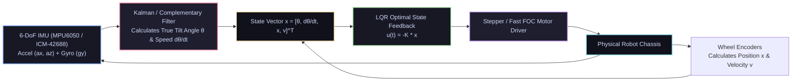

# ⚖️ Self-Balancing Inverted Pendulum Robot (Kalman Filter + LQR)

<div align="center">

[ ⬅️ Back to Projects Directory ](../README.md) &nbsp;•&nbsp; [ 🏠 Hub Home ](../../README.md)

</div>

---

## 📌 Project Overview
The two-wheeled self-balancing robot is the canonical dynamic stabilization platform. Operating as an **unstable, non-linear inverted pendulum**, the robot continuously estimates its tilt angle using sensor fusion on a 6-DoF IMU and commands motor torque to accelerate the wheels in the direction of falling, maintaining balance under disturbances.



---

## 📋 Bill of Materials (BOM)

| Component | Specification | Quantity | Interface / Voltage | Est. Cost (USD) |
| :--- | :--- | :---: | :--- | :---: |
| **Microcontroller** | ESP32-S3 or Teensy 4.0 | 1 | 3.3V Logic / High-Frequency FPU | \$5.00 |
| **IMU Sensor** | MPU6050 (or low-noise ICM-42688P) | 1 | I2C (400 kHz) | \$3.00 |
| **Motors** | NEMA 17 High-Torque Stepper Motors (or BLDC) | 2 | 12V 1.5A per phase | \$22.00 |
| **Motor Drivers** | 2x TMC2209 SilentStepStick Stepper Drivers | 2 | STEP/DIR interface | \$8.00 |
| **Chassis** | 3-Tier Acrylic / 3D-Printed Vertical Tower | 1 | Rigid vertical stack | \$12.00 |
| **Power Source** | 3S LiPo Battery (11.1V, 1500–2200mAh, 30C) | 1 | XT60 | \$16.00 |
| **Regulator** | 5V 3A DC-DC Buck Converter | 1 | Powers ESP32 and logic | \$3.00 |

---

## 🔑 Mathematical Modeling & State Feedback

### 1. Sensor Fusion: Tilt Angle Estimation
* Accelerometer measures both gravity and linear acceleration:
  $$\theta_{\text{acc}} = \text{atan2}(a_x, a_z)$$
  *Problem:* High noise during wheel acceleration and motor vibration.
* Gyroscope measures angular velocity:
  $$\theta_{\text{gyro}} = \theta_{t-1} + \omega_y \Delta t$$
  *Problem:* Low-frequency integration drift over time.
* **Complementary Filter Fusion:**
  $$\theta_t = \alpha (\theta_{t-1} + \omega_y \Delta t) + (1 - \alpha) \theta_{\text{acc}}$$
  where $\alpha \approx 0.98$ (acts as a high-pass filter on the gyro and low-pass filter on the accelerometer).

### 2. Full-State Feedback (LQR)
The system state is represented as:
$$\mathbf{x} = \begin{bmatrix} \theta & \dot{\theta} & x & \dot{x} \end{bmatrix}^T$$
* $\theta$: Pitch angle error from vertical equilibrium.
* $\dot{\theta}$: Pitch angular rate.
* $x$: Linear distance traveled by the wheels.
* $\dot{x}$: Linear velocity of the wheels.

The optimal control law outputs motor acceleration/speed:
$$u = -K \mathbf{x} = - \left( K_1 \theta + K_2 \dot{\theta} + K_3 x + K_4 \dot{x} \right)$$
* $K_1, K_2$: Maintain upright balance (fast inner loop).
* $K_3, K_4$: Prevent the robot from continuously drifting forward or backward (slower outer station-keeping loop).

---

## 💻 ESP32 Real-Time Control Firmware (C++)

```cpp
#include <Wire.h>

// TMC2209 Driver Pins
const int STEP_L = 18;
const int DIR_L  = 19;
const int STEP_R = 21;
const int DIR_R  = 22;

// MPU6050 I2C Address
const int MPU_ADDR = 0x68;

// LQR Gain Constants
const float K1 = 45.0;  // Angle gain (theta)
const float K2 = 2.8;   // Angular velocity gain (d_theta)
const float K3 = 0.05;  // Position gain (x)
const float K4 = 0.12;  // Speed gain (v)

float angle_pitch = 0.0;
float gyro_pitch_rate = 0.0;
float wheel_pos = 0.0;
float wheel_vel = 0.0;

unsigned long last_time;

void read_mpu() {
    Wire.beginTransmission(MPU_ADDR);
    Wire.write(0x3B); // Accel X register
    Wire.endTransmission(false);
    Wire.requestFrom(MPU_ADDR, 6, true);

    int16_t ax = Wire.read() << 8 | Wire.read();
    int16_t ay = Wire.read() << 8 | Wire.read();
    int16_t az = Wire.read() << 8 | Wire.read();

    Wire.beginTransmission(MPU_ADDR);
    Wire.write(0x45); // Gyro Y register
    Wire.endTransmission(false);
    Wire.requestFrom(MPU_ADDR, 2, true);
    int16_t gy = Wire.read() << 8 | Wire.read();

    float acc_angle = atan2((float)ax, (float)az) * 180.0 / PI;
    gyro_pitch_rate = (float)gy / 131.0; // Scaled to deg/sec

    // 200 Hz Complementary Filter
    const float alpha = 0.985;
    angle_pitch = alpha * (angle_pitch + gyro_pitch_rate * 0.005) + (1.0 - alpha) * acc_angle;
}

void setup() {
    Wire.begin(23, 22, 400000); // Fast 400kHz I2C
    pinMode(STEP_L, OUTPUT);
    pinMode(DIR_L, OUTPUT);
    pinMode(STEP_R, OUTPUT);
    pinMode(DIR_R, OUTPUT);

    // Wake up MPU6050
    Wire.beginTransmission(MPU_ADDR);
    Wire.write(0x6B);
    Wire.write(0);
    Wire.endTransmission(true);

    last_time = micros();
}

void loop() {
    // 200 Hz Deterministic Loop (every 5000 microseconds)
    if (micros() - last_time >= 5000) {
        last_time = micros();

        read_mpu();

        // Safety cutoff if fallen beyond 35 degrees
        if (abs(angle_pitch) > 35.0) {
            // Cut motor power
            return;
        }

        // Compute LQR Control Effort
        float u = -(K1 * angle_pitch + K2 * gyro_pitch_rate + K3 * wheel_pos + K4 * wheel_vel);

        // Update wheel metrics
        wheel_vel = u;
        wheel_pos += wheel_vel * 0.005;

        // Command Step Frequency to TMC2209 Drivers
        bool dir = (u >= 0);
        digitalWrite(DIR_L, dir ? HIGH : LOW);
        digitalWrite(DIR_R, dir ? LOW : HIGH); // Inverted right motor
        
        // Generate step pulses proportional to |u|
        int steps = constrain((int)(abs(u) * 2.0), 0, 50);
        for (int i = 0; i < steps; i++) {
            digitalWrite(STEP_L, HIGH);
            digitalWrite(STEP_R, HIGH);
            delayMicroseconds(5);
            digitalWrite(STEP_L, LOW);
            digitalWrite(STEP_R, LOW);
            delayMicroseconds(5);
        }
    }
}
```

---

## 🔧 Tuning Procedure
1. **Find Center of Mass Neutral Point:** Hold the robot upright by hand with power off. Note the exact pitch reading where the robot naturally balances. Bias your `acc_angle` calculation by this offset.
2. **Tune $K_1$ and $K_2$ First:** Set $K_3 = K_4 = 0$. Increase $K_1$ until the robot attempts to right itself; add $K_2$ to damp out oscillations.
3. **Add $K_3$ and $K_4$ for Position Control:** Once upright, adding $K_3$ and $K_4$ will actively drive the robot back to its starting spot if nudged.
