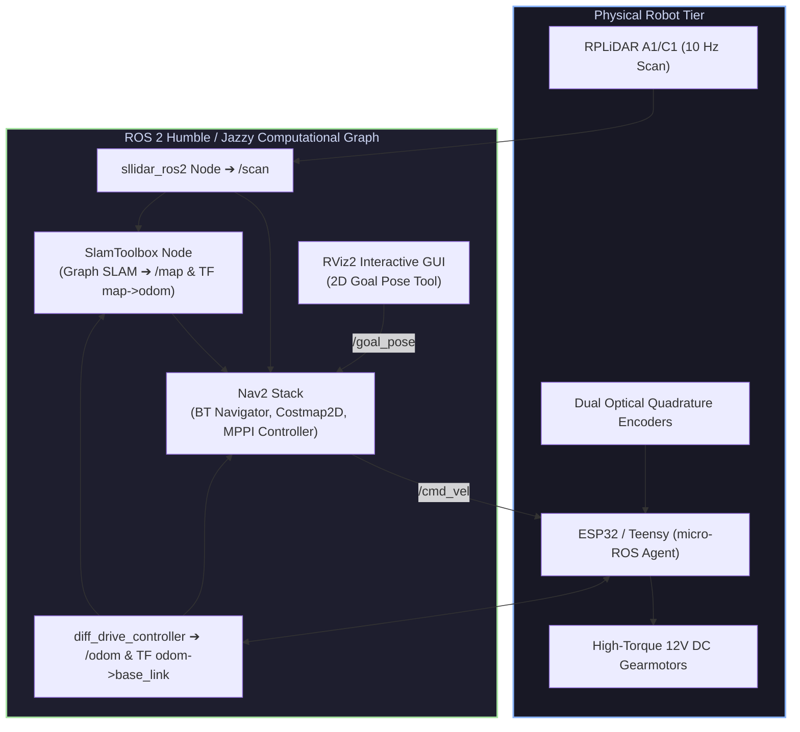

# 🤖 Autonomous 2D LiDAR SLAM & Navigation Rover (ROS 2 Nav2)

<div align="center">

[ ⬅️ Back to Projects Directory ](../README.md) &nbsp;•&nbsp; [ 🏠 Hub Home ](../../README.md)

</div>

---

## 📌 Project Overview
A complete, production-grade autonomous mobile robot (AMR). The rover utilizes a **360° 2D LiDAR** and optical wheel encoders to generate a metric 2D occupancy grid map in real time using **SlamToolbox**. Once mapped, it autonomously plans and executes obstacle-free collision paths to designated $(x, y, \theta)$ goals using the **ROS 2 Navigation 2 (Nav2)** stack.



---

## 📋 Bill of Materials (BOM)

| Component | Specification | Quantity | Interface / Voltage | Est. Cost (USD) |
| :--- | :--- | :---: | :--- | :---: |
| **SBC (Brain)** | Raspberry Pi 4 (4GB/8GB) or Pi 5 | 1 | Ubuntu 22.04 / 24.04 LTS (5V 3A USB-C) | \$65.00 |
| **Microcontroller** | ESP32-S3 or Teensy 4.0 | 1 | micro-ROS USB Serial | \$6.00 |
| **LiDAR Sensor** | Slamtec RPLiDAR A1M8 or C1 | 1 | 360°, 12m Range, USB Serial | \$75.00 |
| **Motor Drivers** | MDD10A 10A Dual Channel Motor Driver | 1 | 5V–30V DC, PWM & DIR pins | \$16.00 |
| **Encodered Motors**| 12V DC Metal Gearmotors + Hall Encoders | 2 | 300 RPM, 330 PPR Encoders | \$26.00 |
| **Power Supply** | 3S LiPo (11.1V, 2200–3000mAh) or 12V LiFePO4 | 1 | XT60 Connector | \$22.00 |
| **Power Converter** | 5V 5A High-Efficiency Step-Down Buck | 1 | Powers Pi and LiDAR safely | \$6.00 |
| **Chassis Kit** | 2WD Aluminum / Acrylic Plate Base | 1 | Castor wheel + 65mm rubber wheels | \$18.00 |

---

## ⚡ Electrical & Communication Architecture

```
Power Distribution:
11.1V LiPo ────┬───> MDD10A Motor Driver Power Rail (Direct High Current)
              └───> 5V 5A Buck Converter ───┬───> Raspberry Pi 5V USB-C
                                            └───> RPLiDAR USB Boost Board

Signal Connections:
RPLiDAR A1 ───(USB Cable)───> Raspberry Pi USB 3.0 (/dev/ttyUSB0)
ESP32 MCU  ───(USB Cable)───> Raspberry Pi USB 2.0 (/dev/ttyUSB1 running micro-ROS)
ESP32 Pins ───> Motor Driver (PWM1, DIR1, PWM2, DIR2)
Motor Encoders ───> ESP32 Hardware Interrupt Pins (GPIO 18, 19, 21, 22)
```

---

## 💻 ROS 2 Software Bringup Walkthrough

### 1. Launching the RPLiDAR Driver
Install the official ROS 2 package:
```bash
sudo apt install ros-$ROS_DISTRO-rplidar-ros
ros2 launch rplidar_ros rplidar_a1_launch.py serial_port:=/dev/rplidar
```

### 2. SlamToolbox Online Sync SLAM Configuration (`mapper_params_online_sync.yaml`)
```yaml
slam_toolbox:
  ros__parameters:
    solver_plugin: solver_plugins::CeresSolver
    ceres_linear_solver: SPARSE_NORMAL_CHOLESKY
    odom_frame: odom
    map_frame: map
    base_frame: base_link
    scan_topic: /scan
    mode: mapping

    # Tuning parameters
    resolution: 0.05             # 5cm per grid cell
    max_laser_range: 12.0
    minimum_time_interval: 0.2
    transform_timeout: 0.2
    tf_buffer_duration: 30.0
    link_match_minimum_response_fine: 0.1
```

Launch SlamToolbox:
```bash
ros2 launch slam_toolbox online_sync_launch.py slam_params_file:=mapper_params_online_sync.yaml
```

### 3. Saving the Generated Map
Drive the robot around using teleop (`ros2 run teleop_twist_keyboard teleop_twist_keyboard`) to map the entire perimeter, then save:
```bash
ros2 run nav2_map_server map_saver_cli -f ~/my_warehouse_map
```

### 4. Autonomous Navigation with Nav2
Launch the full Nav2 autonomy stack referencing the newly saved map:
```bash
ros2 launch nav2_bringup bringup_launch.py \
    use_sim_time:=False \
    map:=$HOME/my_warehouse_map.yaml \
    params_file:=nav2_params.yaml
```

In RViz2:
1. Click **2D Pose Estimate** to give the robot its initial position on the map.
2. Click **Nav2 Goal** anywhere on the map: watch the robot dynamically compute global A*/Smac paths and track them smoothly with the MPPI controller, dodging newly introduced chairs and obstacles!

---

## 🔧 Troubleshooting & Odometry Calibration
* **Symptom: Map doubles or smears walls when turning.**
  * *Root Cause:* Wheel separation distance (`wheel_track`) or encoder pulses per revolution (PPR) is miscalibrated. 
  * *Fix:* Command a 360-degree in-place rotation (`rostopic pub /cmd_vel`). Measure whether the robot physically rotates exactly 360.0 degrees when the odometry reports $2\pi$ radians. Adjust `wheel_separation` in your firmware until calibrated within $1^\circ$.
