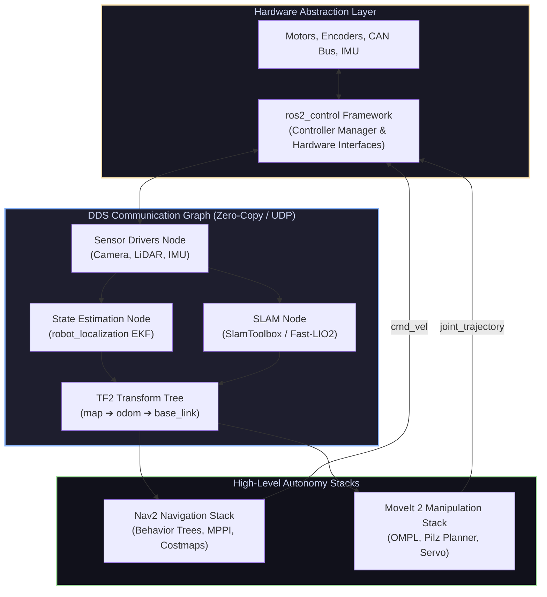

# 🤖 ROS 2 Ecosystem: The Industrial Robotics Nervous System

<div align="center">

[ 🏠 Hub Home ](../README.md) &nbsp;•&nbsp; [ 🗺️ Full Roadmap ](../robotics-roadmap.md) &nbsp;•&nbsp; [ 📑 ROS 2 CLI Cheat Sheet ](../cheatsheets/ros2-cheatsheet.md)

</div>

---

## 📌 Overview & Scope
The **Robot Operating System 2 (ROS 2)** is the global industry standard middleware for robotics software development. With ROS 1 reaching official End-of-Life (EOL), modern robotics operates exclusively on ROS 2 LTS distributions (**Humble Hawksbill** on Ubuntu 22.04 and **Jazzy Jalisco** on Ubuntu 24.04).

ROS 2 replaces legacy centralized masters with industrial **DDS (Data Distribution Service)**, providing real-time deterministic communication, security (SROS2), multi-robot networking, and modular components.



---

## 🔑 Core Architecture & Concepts

### 1. Communication Primitives

```
Primitive   Pattern                Synchronicity   Best Applied To
────────────────────────────────────────────────────────────────────────────────────
Topic       Publish / Subscribe    Asynchronous    Continuous data streams (LiDAR, IMU, /cmd_vel)
Service     Request / Response     Synchronous     Instantaneous queries (GetMap, ResetOdometry)
Action      Goal / Feedback / Result Asynchronous  Long-duration goals (NavigateToPose, PickObject)
Parameter   Key-Value Dictionary   Dynamic Sync    Runtime configs (PID gains, max_speed)
```

### 2. DDS & Quality of Service (QoS)
ROS 2 communicates over DDS vendors (e.g., **eProsima FastDDS**, **Eclipse CycloneDDS**). Communication behavior is configured via QoS policies:
* **Reliability:**
  * `RELIABLE`: Guarantees message delivery via packet retransmission (crucial for `/tf`, `/goal_pose`, and service calls).
  * `BEST_EFFORT`: Delivers packets without acknowledgment; drops late frames to avoid lag (ideal for 30 FPS camera frames and 500 Hz IMU streams).
* **Durability:**
  * `VOLATILE`: No historical samples kept; late subscribers miss past messages.
  * `TRANSIENT_LOCAL`: Latches the last sample; late subscribers immediately receive the existing static map or coordinate frame upon connecting.

### 3. The Coordinate Transform Tree (TF2)
In robotics, every sensor and wheel sits in a different coordinate frame. The TF2 library maintains a directed tree of spatial transformations over time:
$$\text{map} \longrightarrow \text{odom} \longrightarrow \text{base\_link} \longrightarrow \text{laser\_link} \ / \ \text{camera\_link}$$

> [!NOTE]
> **Why separate `map` and `odom`?**
> * **`odom` $\to$ `base_link`:** Computed locally from wheel encoders and IMU. Smooth, continuous, and high-frequency (50–100 Hz), but drifts slowly over distance.
> * **`map` $\to$ `odom`:** Published by SLAM or AMCL localization. Corrects long-term drift via global sensor matching. When loop closure occurs, the `map` $\to$ `odom` transform jumps discretely—allowing the robot's local trajectory controller to remain smooth without jerking!

### 4. Navigation 2 (Nav2) Architecture
The industry-standard autonomous mobile navigation stack:
* **Behavior Tree (BT Navigator):** Orchestrates high-level decisions (Navigate $\to$ ComputePath $\to$ FollowPath $\to$ if stuck $\to$ Spin / Wait / ClearCostmap).
* **Costmap 2D:**
  * *Static Layer:* Occupancy grid from saved SLAM map.
  * *Obstacle / Voxel Layer:* Dynamic obstacles detected in real-time by LiDAR / 3D depth cameras.
  * *Inflation Layer:* Expands obstacles by robot radius + safety margin to prevent collisions.
* **Trajectory Controllers:**
  * **MPPI (Model Predictive Path Integral):** Modern GPU/multithreaded sampling-based predictive controller capable of handling non-linear vehicle dynamics.
  * **Regulated Pure Pursuit (RPP):** Geometric path tracker optimized for Ackermann and differential rovers.

### 5. MoveIt 2 Motion Planning
* The state-of-the-art framework for robotic arm manipulation, inverse kinematics, collision checking, and trajectory execution.
* Integrates **OMPL** (RRTConnect, PRM) for obstacle avoidance in high-dimensional joint space, and **MoveIt Servo** for real-time Cartesian teleoperation via joysticks or visual tracking.

---

## 🛠️ Industry Standard ROS 2 Toolchain

| Tool | Category | Purpose |
| :--- | :--- | :--- |
| **[RViz2](https://github.com/ros2/rviz)** | 3D Visualization | Real-time interactive rendering of robot models, point clouds, laser scans, and planned paths |
| **[Foxglove Studio](https://foxglove.dev/)** | Modern Visualization | Next-generation web/desktop visualization with custom robotics dashboards and live telemetry |
| **[MCAP](https://mcap.dev/)** | Data Logging | Modular container format replacing legacy rosbag with zero-copy random access indexing |
| **[Colcon](https://colcon.readthedocs.io/)** | Build System | Multiprocessing build tool compiling mixed C++ (CMake) and Python workspaces |
| **[ros2_control](https://control.ros.org/)** | Hardware Abstraction | Standardized lifecycle interface between ROS 2 controllers and real actuator drivers |

---

## 📚 Curated Learning Media

### 🎓 Premier Courses & Lectures
- [Articulated Robotics: ROS 2 Tutorials (YouTube)](https://www.youtube.com/@ArticulatedRobotics) — The single most comprehensive, beginner-friendly ROS 2 and URDF build series on the internet.
- [The Construct (YouTube & ROS Academy)](https://www.youtube.com/@TheConstruct) — Practical ROS 2 Humble/Jazzy courses with live simulated robot sandboxes.
- [Navigation 2 Official Documentation Tutorials](https://navigation.ros.org/) — Step-by-step guides for mobile robot navigation bringup.
- [MoveIt 2 Tutorials](https://moveit.picknik.ai/) — Manipulator arm setup, URDF configuration, and MoveIt Servo.

### 📖 Essential Books
- *Programming Robots with ROS* by Morgan Quigley, Brian Gerkey, and William D. Smart.
- *ROS 2 in 5 Days* by The Construct.
- *Mastering ROS for Robotics Programming (3rd Edition)* by Lentin Joseph.

### 💻 Open-Source Repositories
- [ros2/ros2](https://github.com/ros2/ros2) — Core ROS 2 source code.
- [ros-planning/navigation2](https://github.com/ros-planning/navigation2) — Nav2 codebase.
- [ros-planning/moveit2](https://github.com/ros-planning/moveit2) — MoveIt 2 manipulation stack.
- [ros-controls/ros2_control](https://github.com/ros-controls/ros2_control) — Hardware abstraction and real-time controllers.

---

<div align="center">

[ ⬅️ Previous: Control Systems ](../control_systems/README.md) &nbsp;•&nbsp; [ Next: Simulation & Digital Twins ➡️ ](../simulation/README.md)

</div>
