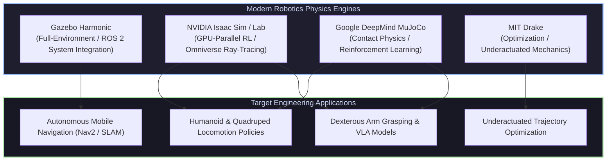

# 🎮 Physics Simulation & Digital Twins for Robotics

[ 🏠 Hub Home ](../README.md) &nbsp;•&nbsp; [ 🗺️ Full Roadmap ](../robotics-roadmap.md) &nbsp;•&nbsp; [ 👁️ Computer Vision ➡️ ](../computer_vision/README.md)

---

## 📌 Overview & Scope
Simulation is where robotics code is tested, validated, and stress-tested before executing on fragile, expensive physical hardware. 

The simulation landscape has fractured into specialized engines:
1. **Full-World Systems Simulators (Gazebo Harmonic):** Simulating entire indoor/outdoor environments, multi-sensor streams, LiDAR point clouds, and full ROS 2 navigation stacks.
2. **GPU-Accelerated Parallel Simulators (NVIDIA Isaac Sim / Isaac Lab):** Simulating thousands of robot instances concurrently on a single GPU for Reinforcement Learning (RL) and synthetic visual training.
3. **Analytic Contact Physics Engines (MuJoCo, Drake):** Delivering microsecond contact dynamics and trajectory optimization for dexterous manipulation and humanoid balance.

---

## 🔑 Modern Simulation Platforms Breakdown

### 1. Modern Gazebo (Gazebo Harmonic / Fortress)
* **Status:** The official next-generation simulator replacing legacy Gazebo Classic.
* **Architecture:** Component-based architecture built on the Ignition/Gazebo modular libraries (`gz-sim`, `gz-math`, `gz-physics`).
* **Interfacing with ROS 2:** Connected via `ros_gz_bridge`, which dynamically translates Gazebo transport messages to ROS 2 topics and vice-versa.
* **Format:** Uses **SDFormat (SDF)** natively, with automated URDF-to-SDF conversion during launch.
* **Best For:** Simulating warehouse mobile rovers, outdoor rovers with GPS/IMU, dynamic obstacles, and testing the ROS 2 Nav2 stack.

### 2. NVIDIA Isaac Sim & Isaac Lab
* **Status:** The gold standard for modern Embodied AI and industrial digital twins.
* **Architecture:** Built on the **NVIDIA Omniverse** platform with **PhysX 5** simulation running entirely on CUDA cores.
* **Massively Parallel Simulation:** Can spawn 4,096+ identical quadruped or humanoid robots simultaneously in a single GPU memory space, stepping physics in parallel to collect millions of reinforcement learning environment steps in minutes.
* **Photorealistic Perception:** Features hardware-accelerated RTX ray tracing, simulating realistic optical lens distortion, depth sensor noise, and materials for training vision models.
* **Best For:** Quadruped/humanoid locomotion training, robotic arm manipulation with RL, and synthetic data generation.

### 3. Google DeepMind MuJoCo
* **Status:** The benchmark physics engine for robotic learning and academic control research.
* **Architecture:** Written in pure C for extreme computational speed, featuring continuous-time contact dynamics modeled as convex optimization problems.
* **Format:** Models are defined using clean **MJCF XML** files.
* **Bindings:** Native Python bindings (`import mujoco`), easily paired with Gymnasium and PyTorch.
* **Best For:** Fast algorithmic benchmarking, trajectory optimization, and learning complex hand/finger dexterous manipulation.

### 4. MIT Drake
* **Status:** Created by the Robot Locomotion Group at MIT.
* **Architecture:** Formulates multibody mechanics and contact as formal mathematical optimization programs.
* **Best For:** Direct collocation trajectory optimization, region of attraction computation (Lyapunov analysis), and contact-implicit MPC.

---

## 🌉 Crossing the Sim-to-Real Gap

Policies trained purely in simulation often fail miserably when transferred to physical robots due to the **Reality Gap**:
* Inaccurate joint friction, motor backlash, and non-linear gearbox compliance.
* Unmodeled sensor latency and packet jitter.
* Contact friction variance between rubber feet and physical flooring.

### Battle-Tested Sim-to-Real Techniques
1. **Domain Randomization (DR):** During simulation training, randomly perturb physical parameters on every episode:
   * Friction coefficient: $\mu \sim \mathcal{U}(0.2, 1.2)$
   * Link masses and center of gravity: $m \sim \mathcal{U}(0.8m_0, 1.2m_0)$
   * Motor actuator latency: $\tau_{\text{delay}} \sim \mathcal{U}(5\text{ms}, 25\text{ms})$
   * Sensor noise and observation bias.
2. **Privileged Learning (Teacher-Student):** Train an RL "Teacher" policy in simulation with access to ground-truth privileged information (exact terrain height map, friction). Then train a "Student" policy via imitation learning that only receives real-world onboard sensor streams (IMU history, joint encoders) to mimic the teacher.

---

## 📚 Curated Learning Media

### 🎓 Premier Courses & Documentation
- [Gazebo Sim (Harmonic) Official Documentation](https://gazebosim.org/docs/harmonic/getstarted/) — Complete installation, worlds, and plugin guides.
- [MuJoCo Documentation (DeepMind)](https://mujoco.readthedocs.io/) — Computational principles and MJCF XML reference.
- [NVIDIA Isaac Lab Documentation](https://isaac-sim.github.io/IsaacLab/) — Modular framework for robot learning on Isaac Sim.
- [Underactuated Robotics (Russ Tedrake, MIT Drake)](https://underactuated.csail.mit.edu/) — Computational dynamics in Drake.

### 📖 Essential Books & Guides
- *Modern Robotics: Mechanics, Planning, and Control* by Kevin M. Lynch and Frank C. Park.
- *Rigid Body Dynamics Algorithms* by Roy Featherstone — The mathematical foundation underlying modern physics engines.

### 💻 Open-Source Repositories
- [google-deepmind/mujoco](https://github.com/google-deepmind/mujoco) — Core MuJoCo physics engine.
- [gazebosim/gz-sim](https://github.com/gazebosim/gz-sim) — Modern Gazebo simulation repository.
- [isaac-sim/IsaacLab](https://github.com/isaac-sim/IsaacLab) — Unified framework for robot learning in Isaac Sim.
- [bulletphysics/bullet3](https://github.com/bulletphysics/bullet3) — PyBullet rigid body dynamics engine.

---

[ ⬅️ Previous: ROS 2 Ecosystem ](../ros/README.md) &nbsp;•&nbsp; [ Next: Computer Vision & 3D ➡️ ](../computer_vision/README.md)

